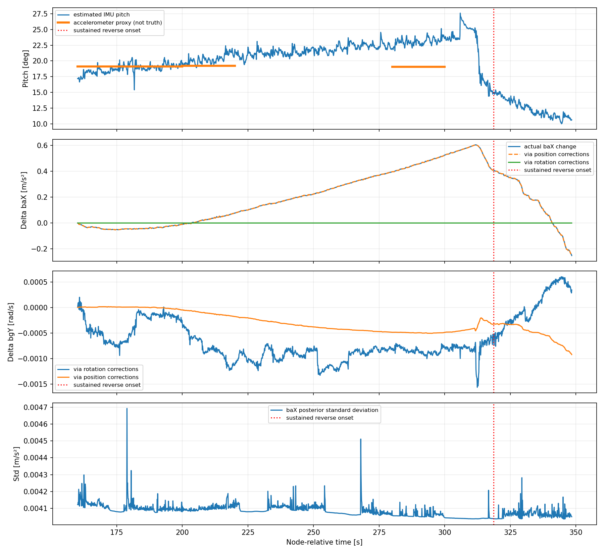

# 姿勢・加速度biasの不整合：対策候補の絞り込み（2026-09-27）

最新の優先順位は[追加幾何データに基づく対処計画（2026-09-28）](UTURN_REMEDY_PLAN.md)を参照。
本書の「bias更新制御を最優先」は幾何情報取得前の方針であり、現在は対応・地図の改善を先に比較する。

追記: 本書で不足とした幾何情報は、その後[別実行の140–325秒について取得済み](GEOMETRY_CAPTURE.md)。
以下の数値は従来の348.4秒停止runに基づく。新runの幾何と混ぜずに扱う。

既存データで、biasの蓄積経路と単純な対策の限界まで確認できた。
最優先の対策候補は、**姿勢・重力との区別がつかない状況でのbias更新を抑え、
信頼できるLiDARの姿勢・速度補正は維持すること**。
並行して、そのbias更新を生む地図・対応点の系統的な誤差を調べる必要がある。
今回の解析だけで根治策が実証されたわけではない。

**原因の確定には318秒より前の地図・対応関係の追加情報が必要**。
ただし、集計・ゲイン・共分散は3.3秒から保存済みで、元bagにも前半の入力がある。
新しい長時間の実機収録や360秒への延長が必要という意味ではない。
必要なのは、同じbagを先頭から再生して、特に140–300秒の地図と対応点を取得すること。
現在の詳細CSVは300秒以降だけで、期間を延ばしても点座標・地図履歴は追加されない。

## 対象と今回の作業

- 対象は[途中停止ログの分析](SECOND_UTURN_DIAGNOSIS.md)と同じ
  `run-1790502604762878662-0`。保全先は `/tmp/fast-livo2-uturn2-hhrpwvwg/`。
- 全3,452スキャンの採用反復を使用。時刻・採用反復・状態更新との一致を検査した。
- 対応点の追加集計は300.099480–348.399713秒、採用反復484個。
- 開始時のGit状態・差分・履歴をhandoffと照合。既存変更を保持し、推定コード・較正・YAMLを変更していない。
  再生やビルドも行っていない。今回の追加物は解析スクリプト・集計・図と本書。
- 数値的な更新整合性は確認できるが、姿勢・biasの真値はない。以下では観測事実と仮説を区別する。

## 1. 加速度biasが増えた直接の更新経路

姿勢・位置を `q`、速度とbiasを `z` とすると、このrunのLiDAR観測と制約はposeだけに作用する。
保存した各反復の事前共分散から、次の関係で補正を分解できる。

```text
Δz = P_zq (P_qq)^(-1) Δq
Δq = [回転の右摂動3成分, world位置補正3成分]
```

ここで `Δ` は採用反復の `K * innovation`。
全スキャンで上式と実際の速度・bias補正が一致し、最大絶対誤差は **1.36e-15**。
これは補正の配分を示す恒等式で、回転・位置を独立した物理原因と断定するものではない。

| 区間 [s] | accel bias Xの変化 [m/s²] | 回転補正経由 | 位置補正経由 |
|---|---:|---:|---:|
| 180–200 | +0.034851 | +0.0000097 | +0.034841 |
| 200–220 | +0.086444 | +0.0000261 | +0.086418 |
| 220–260 | +0.208896 | −0.0000180 | +0.208914 |
| 260–300 | +0.239734 | −0.0000290 | +0.239763 |
| 300–310 | +0.066172 | +0.0000086 | +0.066164 |
| 315–320 | −0.116736 | −0.0000033 | −0.116733 |

180–310秒の合計は+0.636097 m/s²、そのうち位置経由は+0.636099 m/s²。
**加速度biasはほぼ全量がLiDARの位置補正を通じて変化している。**
姿勢方向のLiDARゲインだけを変更しても、この経路は直接には止まらない。

ジャイロbias Yは、200–220秒に回転補正経由−0.00079843、位置経由−0.00012797 rad/s。
この初期区間では回転経由が支配的だった。一方、200–300秒全体では
回転−0.00047158、位置−0.00043799 rad/sで、長期の位置経由も無視できない。
同じ200–220秒にpitchはIMU予測で+1.038°、LiDAR更新で+1.456°変化した。
その後280–300秒は、予測+1.642°に対してLiDAR更新は+0.000568°にとどまる。

したがって有力な仮説は、**初期の回転・位置補正がジャイロbiasにも入り、
その後の姿勢のずれに伴う並進予測誤差を加速度biasが吸収する循環**。
その最初の補正が地図誤差、実際の運動、実bias変化のどれを反映したかはまだ確定できない。



## 2. 姿勢のずれをbiasが吸収する大きさと方向

IMU予測は `a_W = R (s a_raw - b_a) + g`。
`f = s a_raw - b_a` とおくと、微小な姿勢変化・bias変化による加速度変化は

```text
δa_W ≈ −R [f]× δθ − R δb_a
δb_a ≈ −[f]× δθ なら、この変化が相殺される。
```

180–200秒の平均と280–300秒の平均を比較すると:

- 推定pitch: **19.126° → 23.087°**、差+3.960°。
- raw加速度の重力のみ仮定によるpitch指標: **19.127° → 19.057°**。
- accel biasの差: **[+0.4911, +0.2140, +0.1905] m/s²**。
- pitchだけが3.960°変わる局所モデルの相殺bias: **[+0.6412, 0, +0.2183] m/s²**。
- bias差に最も合うpitchだけの変化は約3.077°。残差は
  **[−0.0071, +0.2140, +0.0209] m/s²**で、X/Zの方向・大きさはよく対応する。

これは姿勢とbiasの取り違えを支持する材料。ただし加速度由来の指標は走行中の姿勢真値ではなく、
Euler pitchをbody Yの微小回転と近似した局所計算でもある。
Y成分はこのpitchだけのモデルでは説明していない。実センサーbias変化の否定にもならない。

Uターンではbody座標に保持されるbiasのworld方向が変わる。
地図・推定姿勢と固定重力方向のずれをbody biasが一時的に吸収していた場合、
方向転換後にその相殺が崩れる。この説明は保存した加速度分解と整合する。
初期重力方向の誤り、途中の地図傾斜、姿勢ドリフトのどれかまでは識別できない。

**biasだけのリセットでは足りない。** 315–320秒では、保存姿勢でbias項を除いても
`R s a_raw + g` のworld-X平均は **−0.759 m/s²**。
bias項−0.458を加えると−1.217、実際の予測は−1.215 m/s²だった。
これは同じ姿勢における近似計算で、リセット後の軌跡ではないが、
biasだけを0へ戻す方法が姿勢・重力側の問題を残すことを示している。

## 3. LiDARを一律に弱める対策の限界

保存した状態・共分散・対応点を固定し、全観測の分散だけを変更して無制約ゲインを再計算した。
元の分散は現在のikd-tree経路で1点あたり0.001 m²。
以下は各保存状態での補正の和で、変更後の再生軌跡ではない。
X-ICP制約は比較対象すべてから外している。

| 観測分散の倍率 | 200–300秒のΔbias X [m/s²] | 320–325秒の速度X補正 [m/s] |
|---|---:|---:|
| 1倍 | +0.4361 | +2.2150 |
| 10倍 | +0.1663 | +0.9900 |
| 100倍 | +0.0327 | +0.1787 |

観測を弱めるとターン前のbias蓄積は小さくなるが、
後退を打ち消すLiDARの速度補正も大幅に減る。
逆に強めると回復方向の補正は増えるが、ターン前のbias蓄積も増える。
**観測ノイズ1個の調整だけを根治策として選ぶ根拠はない。**
実際のX-ICPありの200–300秒のΔbias Xは+0.5351、320–325秒の速度X補正は+1.6363。
この差も制約と他状態の結合による配分を示すが、無効化による長期改善の証明にはならない。

### どの対応点が補正を担うか

採用反復の全対応点をworld法線で分類した。法線のいずれかの成分の絶対値が0.85以上ならその軸、
残りを斜め群とした。各群の `K_i * innovation_i` を合計し、
元の補正との最大誤差 **8.88e-16** を確認した。

320–325秒ではworld-Xに近い法線の群は2,570点、全80,685点の約3.2%しかないが、
速度Xの補正+1.6363 m/sのうち+0.6475を担う。
斜め群9,337点も+0.6170を担い、この二群で約77%となる。
両群の残差RMSは0.0822 / 0.0785 m、world-Z法線群は0.0293 m。
300–310秒でも斜め群はbias X補正+0.06617のうち+0.03536を担っている。

進行方向の情報が比較的少数・残差の大きい対応点に依存している。
それらを一律に外れ値として除くと、回復に必要な情報も失うおそれがある。
実際の面・距離・近傍点を調べて重みを変える必要があり、法線分類だけでは誤対応と判定できない。

## 4. 実装を調べて分かったこと

- [IMU伝播](../humble_ws/src/fast-livo2/src/IMU_Processing.cpp)はbiasを引いて積分している。
  回転―ジャイロbias、速度―姿勢、速度―加速度biasの伝播ブロックについて、
  今回確認した符号・座標系から単純な反転バグは見つからなかった。
- 主な伝播ブロックと`dt²`のプロセスノイズは
  [FAST-LIVO2の上流実装](https://github.com/hku-mars/FAST-LIVO2/blob/main/src/IMU_Processing.cpp)と同じ形。
  したがって単に`dt²`を`dt`へ変える修正は根拠不足。
  連続時間ノイズ密度かサンプル分散かを定義し、実データで較正してから判断する。
- 反復時のSO(3)事前共分散の接空間変換は、確認した
  [FAST-LIO/IKFoMの処理](https://github.com/hku-mars/FAST_LIO/blob/main/include/IKFoM_toolkit/esekfom/esekfom.hpp)
  と同じ右Jacobian転置の形。今回の点検はコード全体の無欠陥を保証しない。
- [X-ICP更新](../humble_ws/src/fast-livo2/src/xicp_update.cpp)は実際の制約付きゲインでJoseph共分散を更新する。
  記録でも補正・制約の恒等式が成立。318.59985秒の初反転では制約0で、6方向FULLだった。
- [現在の対応点処理](../humble_ws/src/fast-livo2/src/voxel_map.cpp)は5近傍で平面を当てはめ、
  採用点には同じ0.001 m²の分散を使う。ikd-tree経路では地図平面の共分散を0にし、
  同じ地図から来る観測間・状態との相関を明示的に表していない。
  小さい状態共分散だけでbias更新を信頼できるとは言えない。
- biasのプロセスノイズは[初期設定](../humble_ws/src/fast-livo2/src/LIVMapper.cpp)でgyro/accelとも0.0001に固定。
  個別に較正可能な設定にする余地はあるが、この数値が直接の原因とまでは言えない。

## 5. 対策の優先順位と成立条件

### 第一候補：biasを更新する条件を、姿勢・速度の補正から分ける

狙いは、位置補正が観測しきれない姿勢誤差・地図誤差を加速度biasへ押し込む経路を弱めること。
加速度biasとジャイロbiasは別々に扱う。
単一スキャンの6×6ヘッセがFULLであることは、時間を通じて姿勢・biasを分離できる保証ではない。

実装するなら、一定時間のIMU伝播・LiDAR観測の情報と運動の励起を使い、
区別できないbias方向のゲインを抑える。良い位置観測がある場合の速度補正は残す。
変更後のゲインを `K'` とした場合、共分散も必ず

```text
P+ = (I − K'H) P− (I − K'H)^T + K' R K'^T
```

で整合させ、更新後のbias値だけをクリップしたり、平均を固定したまま確信度を上げたりしない。
これは設計候補で、ゲート閾値は未決定・改善は未検証。
既に誤ったbiasが蓄積した後で凍結しても回復しないので、180–220秒より前から検証する。
既往のgravity/bias両固定で悪化したユーザー結果とも区別する必要がある。

### 第二候補：地図・対応点の信頼性を重みに反映する

床・壁の法線や位置が時間とともに変わっていないか、別面を5近傍で混ぜていないかを確認する。
問題が確認できたら、平面適合誤差・近傍の広がり・地図の不確かさに基づく重み付け、
同じ面の点が増えただけで情報が過大にならない処理を検証する。
現時点でvoxel-plane方式への切替や全点の一律除外を推奨する証拠はない。
進行方向に効く少数の点を残せることも評価条件にする。

### 第三候補：独立した拘束で姿勢・biasを分離する

確実な停止区間があるなら静止時の速度・角速度拘束を、信頼できる車輪速度等があれば速度拘束を使う。
床法線も、実際に水平と分かる場合に限って姿勢の基準になり得る。
同じIMUから作った重力指標を、独立した観測として二重に融合しない。
走行中の加速度からpitchを強制設定したり、取り付け角を無視してpitch=0にしたりしない。
今回のbagに車輪速度・姿勢真値はないため、この方法の効果は現ログでは検証できない。

固定重力方向と地図座標の不整合が確認された場合は、初期重力合わせ、地図・状態の座標整合、
必要に応じた重力方向推定を比較する。`gravity_est_en`の有効化だけで解消すると断定はできず、
重力・姿勢・biasを自由にした場合の曖昧さも検証する。

## 6. 次に必要な記録と合否判定

追加するなら**140–325秒**を推奨する。最初のUターン後の立ち上がり、200–220秒の変化、
蓄積区間、二回目のターンを同じ実行でつなぐため。
最重要は170–230秒と290–325秒だが、間の地図履歴も必要になる。
既存の全区間行列ログは継続し、追加するのは以下。

1. deskew後のスキャン点のIMU/body座標とworld座標、元の点との対応ID。
2. 採用した5近傍の座標、面の法線・中心・オフセット、平面適合誤差、採否と理由。
3. 地図の追加・削除・再構築履歴、または対応関係を再現できる局所地図スナップショット。
4. 各時点の姿勢・外部較正・時刻。現在の通常ログは丸められているため、照合用には十分な精度で記録する。

現CSVの`point_index`はその反復の採用対応点の番号で、スキャンや地図をまたぐ点IDではない。
既存の300秒以降のCSVでも完全な地図照合はできない。
容量と再生タイミングへの影響を減らすには、最終反復の記録や局所地図の間引き保存を設計する。
今回と同じ全反復CSVを140秒から出すだけでは、この不足は埋まらない。

対策の比較は同じbag先頭から実行し、少なくとも二回目のターン後まで評価する。
見る量は、ターン前の姿勢・biasの漂い、予測とLiDAR補正の累積差、
ターン後の機体前方速度、残差・対応点・共分散、および地図の面の整合。
raw入力の一致と実行間のばらつきも確認する。
正解軌跡がなければ「精度改善」まで言い切らず、既知の前進と矛盾する持続後退が消えるかをまず判定する。

## 保存結果と再現

- [全区間の補正経路・感度・局所姿勢モデル](diagnostics/attitude_bias_20260927/coupling_summary.json)
- [対応点の法線別集計](diagnostics/attitude_bias_20260927/normal_groups.json)
- [元ログのSHA256 manifest](diagnostics/uturn2_20260927/manifest.json)

リポジトリ直下から実行する。Python、NumPy、図生成にはMatplotlibが必要。

```bash
PYTHONNOUSERSITE=1 OPENBLAS_NUM_THREADS=1 MPLCONFIGDIR=/tmp/mpl-attitude-bias \
  python3 docs/diagnostics/attitude_bias_20260927/analyze_coupling.py \
  /tmp/fast-livo2-uturn2-hhrpwvwg --output /tmp/attitude-bias-analysis

PYTHONNOUSERSITE=1 OPENBLAS_NUM_THREADS=1 \
  python3 docs/diagnostics/attitude_bias_20260927/analyze_normal_groups.py \
  /tmp/fast-livo2-uturn2-hhrpwvwg --output /tmp/attitude-bias-analysis
```
