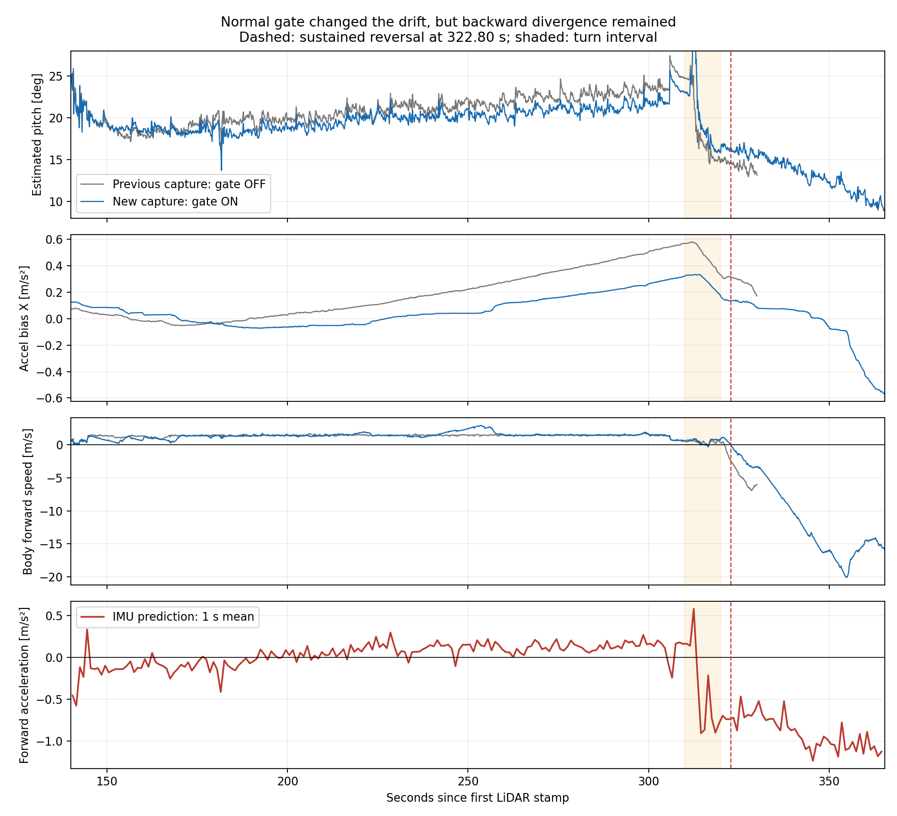
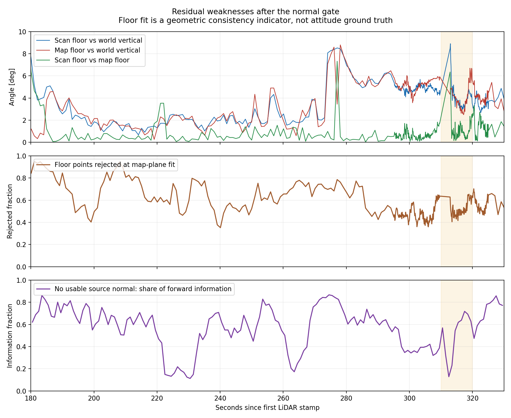

# 法線ゲートを有効にした検証の分析（2026-09-28）

**ゲートは記録上、設計どおりに働いた。しかし後退は解消せず、322.80秒から持続した。**
明白な別面への対応を除くことと、姿勢・地図・加速度biasの整合性を保つことは別の問題だった。
前回方針の弱点は、前者を後者の主要な解決手段として優先したことにある。
対策の優先順位は[改訂した対処計画](UTURN_REMEDY_PLAN.md)へ反映した。

今回の失敗理由の分析には、現在の記録で足りる。追加取得を待つ必要はない。
ただし、最初に地図・姿勢がずれた物理的原因の特定と、修正後の有効性の実証は別に残る。
本作業は解析と計画の改訂であり、推定器・設定・バイナリの変更やbagの再生は行っていない。

## 1. 対象とデータの信頼性

- 取得先: `diagnostic_captures/normal-gate-20260928-071728-w6d4ljyu/`
- run: `run-1790579862998301727-0`。LIO-only、法線ゲートON、30°、20近傍、地図幅0.5 m。
- LIO更新: **3.299–365.400秒、3,622スキャン、14,205反復**。全スキャンのstatusは`updated`。
- 詳細幾何: **3.299–359.999秒、3,568スキャン、15,854,605候補点、5,576,109採用点**。
- 保存された60ファイルのソースハッシュは現在のファイルと全件一致。
  バイナリSHA256もhandoff第17節の`f979f528…447f`と一致。
- 開始時に両repoの`git status`、`git diff`、`git log --oneline -5`を確認。
  HEADは親`7c261e9`、内部`f281e70`で、handoffと整合。既存差分を保持した。

停止時にnodeとRVizが−11で終了したため、captureの自己判定は`incomplete`。
これを正常終了と読み替えてはいない。その上で保存済みCSVを全件検査し、
完了済みスキャンの結合、法線角度と棄却判定、残差、ヤコビアン、ゲイン寄与、
結合ヘッセ行列、補正と制約、共分散の対称性・半正定値性の検査はすべて通った。
したがって、終了異常から今回の後退までをログ破損として片付ける根拠はない。

| 検査 | 結果 |
|---|---:|
| 記録された補正の恒等式の最大誤差 | 3.33×10⁻¹⁶ |
| 制約式の最大誤差 | 2.50×10⁻¹⁶ |
| 事後共分散の非対称成分の最大値 | 1.59×10⁻²² |
| 事後共分散の最小固有値 | 1.00×10⁻⁸ |
| 点ごとに再構成した結合ヘッセ行列の最大規格化誤差 | 4.91×10⁻¹¹ |
| 連続するLIO時刻の間隔 | 97.70–102.26 ms |

IMU監視は74,151件、最大間隔8.35 ms、時刻逆転・20 ms超欠落は0件。
監視subscriberだけでは推定器への入力を保証しないため、処理側の`imu.txt`も照合した。
前回OFF記録と重なる140–325秒の**37,001行は、時刻・角速度・加速度が全行完全一致**した。
法線計算時間は中央値12.46 ms、95%点20.42 ms。
今回の結果を入力欠落だけで説明する証拠はない。ただし、この比較だけで実行順序や並列地図処理まで同一とは主張しない。

## 2. 改善した部分と、残った後退

比較対象OFFは前回の`run-1790505839456699151-0`。同一実行のON/OFF切替試験ではない。
下表の「継続的後退」は、20秒以後に前方速度が20スキャン連続で負になる最初の時刻である。
前方速度は推定IMU姿勢のX軸への速度射影であり、速度真値ではない。

| 指標 | 前回OFF | 今回ON |
|---|---:|---:|
| 継続的後退の開始 | 321.10 s | **322.80 s** |
| 180–310秒の加速度bias Xの変化 | +0.606 m/s² | **+0.359 m/s²** |
| 同区間のpitch変化 | +4.701° | **+4.077°** |
| そのうちIMU予測／LiDAR更新の累積寄与 | +4.677° / +0.024° | **+0.681° / +3.395°** |
| 200–220秒の床点の地図平面適合棄却率 | 86.4% | **74.7%** |

床面の棄却やbiasの蓄積は部分的に減ったが、持続的後退は約1.70秒遅れただけだった。
今回の推定前方速度は354.90秒に**−20.07 m/s**まで達した。
なお、この後半の値を、約330秒までの前回記録との直接比較には使っていない。

姿勢ドリフトの内訳も変わった。今回はLiDAR更新がpitch変化の大半を占める。
「前回と全く同じ更新経路」「gyro biasだけが原因」とは言えない。
一方、bias X補正+0.35860 m/s²のうち、姿勢・位置補正との条件付き共分散で分解した
位置成分経由は+0.35825 m/s²。位置の整合をbiasへ反映する経路は残っている。
これは保存されたゲインの分解であり、その経路を削除した再生結果ではない。

## 3. なぜ法線ゲートだけでは足りなかったか

### 3.1 法線が判定不能な点に、強い観測が残った

実装は、品質基準を満たすスキャン法線だけを地図法線と比較する。
品質基準を満たさない点は以前の判定へ戻り、採用されれば他の点と同じ観測分散を使う。
この例外は稜線などを一律に捨てないための設計だったが、観測の信頼度を補う処理はなかった。

| 区間 | 法線判定不能群の採用点比率 | 同群の前方情報量の比率 | 同群のbias X補正寄与 |
|---|---:|---:|---:|
| 180–200 s | 18.3% | **71.9%** | −0.04273 m/s² |
| 200–220 s | 13.5% | **63.8%** | +0.00622 m/s² |
| 260–300 s | 17.8% | 46.1% | **+0.11504 m/s²** |
| 180–310 s | 15.7% | 39.9% | **+0.18033 m/s²** |

180–310秒の判定不能な採用点290,968点の内訳は、近傍半径超過94,455点、
非平面184,856点、面の広がり不足11,657点。
同区間のbias X補正の約50.3%がこの群の寄与だった。

ただし、**判定不能＝誤対応ではない**。上表の情報量は
`Σ w (n_world · e_forward_horizontal)²`であり、回転を周辺化した可観測性ではない。
点ごとの補正寄与は保存された全点ゲインでの`K_i innovation_i`の和で、
その点を除外した効果とは異なる。無条件に全棄却する根拠にはしない。

同じ事前状態でX-ICPを外し、ゲインだけ再計算した感度検査では、180–310秒のbias X補正和は
全採用点`+0.30892`、法線利用可能点のみ`−0.05997`、さらに角度差5°以内のみ`+0.17369 m/s²`だった。
観測集合で結果が大きく変わり、角度を厳しくすれば単調に良くなるわけでもない。
これは再対応・地図更新・IMU再伝播を伴わない局所検査であり、次の対策の成功予測値ではない。

### 3.2 地図と姿勢が一緒に傾くと、相互の法線は一致する

近距離スキャンの床候補を、地図を使わずにRANSACと中心化PCAで求めた。
同じ床点が実際に参照した地図の5近傍群にも平面を当てた。

| 区間 | スキャン床面のworld傾斜 | 地図床面のworld傾斜 | 両面の角度差 | スキャン床面RMS |
|---|---:|---:|---:|---:|
| 200–220 s | 1.38° | 1.47° | 0.38° | 6.79 mm |
| 300–310 s | **4.85°** | **5.32°** | **0.58°** | 6.61 mm |

各値は中央値。前者は1 Hzの20スキャン、後者は全100スキャン。
床候補150点以上・RMS 15 mm未満を集計した。
この広い床面の法線は、ゲートが使う点ごとの20近傍法線とは区別する。

地図も推定姿勢から作られるため、誤差を共有した面同士は小さな角度差で整合し得る。
30°を15°にしても、この種類のずれを直接検出できない。
今回の床傾斜は整合性の指標であり、水平な床や姿勢の真値を証明するものではない。
スキャン自体もIMUで歪み補正済みなので、独立な姿勢センサーとは扱わない。

### 3.3 床の情報不足と地図更新は、そのまま残った

今回も床点の地図平面適合棄却率は180–200秒72.4%、200–220秒74.7%。
この棄却は法線ゲートより前に起こるため、ゲートは失われた面情報を取り戻せない。

また、`LIVMapper::handleLIO`からの地図更新は採用対応集合とは別にスキャン点群を受け取り、
`UpdateFastLioMap`とikd-tree内部は引き続きボクセル中心への距離で代表点を選ぶ。
**対応から外すだけでは、誤った姿勢で地図を成長させる経路を止められない。**
地図を細かくするだけでも、面や姿勢の誤差を共有する問題は残る。

## 4. 後退を直接生む予測と、X-ICPの役割

315–320秒の実際のIMU予測による前方加速度は平均**−0.699 m/s²**。
保存姿勢と処理済みIMUで近似分解すると、biasを除いた姿勢・重力補償側が
**−0.452 m/s²**、bias側が**−0.243 m/s²**で、両方が後退側に働く。
320–322.8秒ではそれぞれ−0.578、−0.143 m/s²となる。

分解はスキャン終端姿勢をIMU区間へ対応させ、初期平均加速度normのログ値0.9997で換算した近似。
真の運動加速度も含むため、各項をそのままセンサー誤差とは呼ばない。
記録された重力は全詳細区間で`(0,0,−9.81)`と一致する。
実際の予測加速度は、前スキャン事後速度と現在事前速度の差から別途求めた。
**biasをゼロにするだけでも、保存姿勢のままでは持続的な後退加速度が残る。**

322.79975秒の反転時は次のとおり。

| 値 | 結果 |
|---|---:|
| 前スキャンの事後前方速度 | +0.01395 m/s |
| 当スキャンの事前前方速度 | −0.06521 m/s |
| 事後前方速度 | −0.06975 m/s |
| 予測による前方加速度 | −0.79261 m/s² |
| 実際のLiDAR速度補正の事前前方軸成分 | −0.00443 m/s |
| 同状態での無制約ゲインの速度補正成分 | +0.00254 m/s |

事後前方速度には姿勢軸の変化も含むため、表の前方速度差と固定軸への補正射影は厳密には同じ量ではない。

**前回の反転時は制約0件だったが、今回は2件。**
回転の1方向がPARTIAL、並進の1方向がNONEだった。
NONE並進軸と事前の機体前方軸の内積絶対値は0.932。
この方向のLiDAR補正を止めることで、偏ったIMU予測に依存する構造が表に出た。
ただし無制約の同状態補正も、この瞬間の約0.079 m/sの予測減速を埋められない。
315–320秒では実際の前方補正累積+4.288 m/sが無制約+3.675 m/sより大きく、
「X-ICPが一貫して回復を妨げた」とも言えない。

X-ICPを外すだけで根治できる証拠はない。逆に、退化判定が正しくても、
誤った初期予測を真値へ戻す情報は生まれない。この限界は原論文でも説明されている。
[X-ICP原論文](https://arxiv.org/html/2211.16335v4)

## 5. 根本問題として扱う範囲と、断定しない範囲

記録から確認できるのは、**信頼性の不十分な面情報と、情報が欠ける方向が共存し、
位置・姿勢・bias・地図が誤差を吸収し合った状態でターンを迎え、
その後のIMU予測をLiDAR補正が支え切れない**という経路である。
単一スキャンの法線一致や大きなヘッセ固有値は、この状態の正しさを保証しない。

300–310秒の事後標準偏差中央値は、回転接空間で約0.075°、0.028°、0.039°、
加速度biasで約0.0041、0.0043、0.0040 m/s²だった。
これらはEuler角の誤差棒ではなく、地図の傾きや対応誤りも表していない。
数値的な正定値性が通ることと、実際の推定誤差に対して共分散が適切なことは別である。

現在のikd-tree経路は採用点に同じ`R=0.001 m²`を使い、地図平面の分散を0としている。
姿勢誤差を共有する地図を、多数の独立で精密な観測として数える点を改める必要がある。
FAST-LIVO2原論文が扱う点・面・姿勢の不確かさと、現在のikd-tree経路を同一視しない。
[FAST-LIVO2原論文](https://arxiv.org/html/2408.14035v2)

一方、実機の姿勢・速度・biasの真値はない。
最初のずれをIMU較正、LiDARの距離依存誤差、時刻・歪み補正、地図の代表点保持の
どれか一つに確定する証拠もまだない。今回ONでは先頭–140秒の幾何も得られたが、
地図点の生成・保持履歴は記録されていない。前回OFFには同区間の詳細幾何がない。
「さらに318秒以前を取り直さないと何も分からない」という状態ではなくなった。

## 6. 成果物と再現

- [集計JSON](diagnostics/normal_gate_failure_20260928/summary.json): 全点寄与、区間集計、整合性検査、出典run。
- [再現手順・解析スクリプト](diagnostics/normal_gate_failure_20260928/README.md)。
- 保存した派生キャッシュ: `diagnostic_captures/normal-gate-analysis-20260928/`。
  元の取得データは変更せず、巨大CSVから選んだ627スキャンの幾何・採用点、全点集計、状態系列を別保存した。

全点の品質・ゲイン寄与は3,568スキャンを網羅する。
床面解析のみ、全体約1 Hzと295–325秒の全スキャンを使用する。
角度・biasの閾値探索や閉ループの反実仮想再生を実施した結果ではない。
