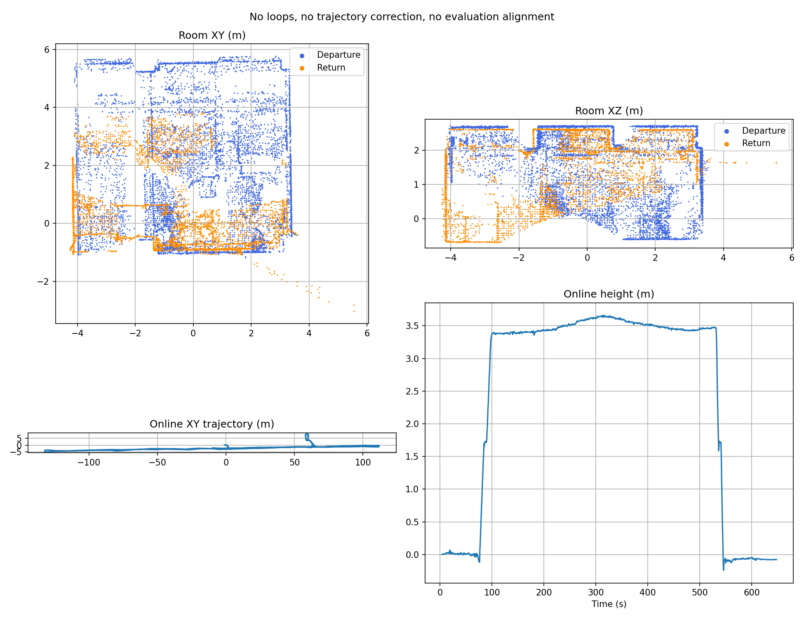

# raw_20260907_114335 のオンライン推定改善

**相対面による整合性修正のLIOを今回の採用版とする。帰着精度は大幅に改善したが、反復で最大約27 cmの壁ずれが残る。**
2026-10-01 03:55 JST時点で、同じビルド・設定のLIO全648秒を2回完走した。
出発・帰着の対向するX壁の差は1回目4.2–5.4 cm、2回目25.6–26.8 cm。
横壁は10.7 / 2.6 cm、天井は6.6 / 4.5 cm。点群・姿勢の位置合わせは行っていない。
従来のX壁差78–79 cmより改善したが、良かった1回だけを採用根拠にしない。
[同じ縮尺で見た旧版・修正版2回の部屋](diagnostics/online-20260930/relative-plane-room-comparison.png)。
[1回目の対向壁](diagnostics/online-20260930/relative-plane-fast-lio-wall-separation.json)、
[2回目の対向壁](diagnostics/online-20260930/relative-plane-fast-lio-repeat-wall-separation.json)、
[全区間反復](diagnostics/online-20260930/relative-plane-fast-lio-full-repetition.json)。
階段の往復点群の最近傍中央値は12.0 / 15.1 cm、上階廊下は4.6 / 5.1 cm。
これらは再観測点群の一致度で、外部の正解軌道による絶対誤差ではない。
475–489秒のUターン区間の推定高さの変動幅は3.5 / 3.3 cm。
階段下降中のLiDARによるZ修正量の95パーセンタイルは2.55 / 2.44 cmだった。
[全区間の高さ・bias・Z更新の比較](diagnostics/online-20260930/relative-plane-full-motion.png)。

同じ観測でも初期の位置共分散によって推定位置が変わる不整合を合成試験で再現し、修正した。
面距離を窓内の推定位置から表し、基準姿勢を窓から除くときは法線・距離・両姿勢のpriorの交差項も変換する。
これは固定した位置拘束や帰着拘束の追加ではない。
[不観測方向の検証](diagnostics/online-20260930/relative-plane-gauge-validation.json)、
[固定したビルド・設定](diagnostics/online-20260930/relative-plane-fast-full-manifest.json)、
[全区間の検査](diagnostics/online-20260930/relative-plane-fast-validation-complete.json)。
16件のC++試験、全区間の入力件数・有限値・共分散の検査に成功した。
1回目の地図589,708点とTUM 1,215姿勢も保存し、TUMは元の推定値から出力桁の丸め差だけであることを確認した。
[保存値の検証](diagnostics/online-20260930/relative-plane-fast-lio-export-integrity.json)。
通常ROSのLIVO60秒は、直接readerのLiDAR283更新・画像282更新と状態・共分散が保存精度で一致した。
LIOの通常ROS60秒も567更新・数値500列が、直接reader60秒および全区間先頭と保存精度で完全一致した（処理時間を除く）。実効設定差0、正常終了。
[LIOの照合](diagnostics/online-20260930/dds-relative-plane-fast-lio60-comparison.json)。[LIVOの照合](diagnostics/online-20260930/dds-relative-plane-fast60-comparison.json)。

相対面による修正版LIVOも2回完走したが、帰着X壁差は約1.23 m／1.95 mで、この設定は採用しない。
上階往復のNN中央値は3.7 cmでも帰着部屋は重ならず、反復の終端位置差は約0.719 mだった。
[修正版LIVOの対向壁](diagnostics/online-20260930/relative-plane-fast-weak-wall-separation.json)。
定数残差だけを除く追加版も全648秒を2回完走し、16試験と通常ROS60秒の一致を確認したが、採用しない。
帰着X壁差は40.5–41.1 cm / 89.5–90.1 cm、天井差は24.0 / 24.3 cmへ悪化した。
反復の終端位置差も48.8 cmで、相対面LIOの23.0 cmより大きい。
定数コストによる受け入れ幅の拡大は減ったが、これを帰着誤差の主因とは確定できなかった。
この修正は独立ビルドで比較し、本体source/installには適用していない。
[追加版の同じ壁・天井](diagnostics/online-20260930/constant-prior-surfaces.json)、
[追加版の全区間検査](diagnostics/online-20260930/constant-prior-validation-complete.json)、
[採否・使用バイナリの記録](diagnostics/online-20260930/online-selection.json)。

直前の連続画像追跡版は全区間を完走した。弱い並進方向だけに画像を使う設定でX壁のずれは約0.91 m、
全方向へ使う設定では約2.16 m。前者の上階往復の最近傍中央値は5.4 cmでも、帰着部屋は重ならない。
長い壁に沿うずれを最近傍距離だけでは捉えきれないため、同じ部屋の対向する壁を別々に近似して確認した。
[壁の支持領域と測定値](diagnostics/online-20260930/deferred-image-wall-separation.json)。

以下は比較履歴。旧nativeビルドの良かった単回の結果を、現在の推奨設定や再現できた精度として扱わない。
`confidence-sat100-lio` は全648秒を完走し、出発・帰着の共通壁の差は11.6–15.0 cm、天井は10.5 cmだった。
同じバイナリ・設定の `confidence-sat100-repeat` も正常完走したが、帰着で約0.88 mの水平ずれが残った。
両実行の終端位置差は0.728 m、再試験のNN中央値は0.500 m。後退・大きな縦揺れは抑えられたが、
良かった1実行だけを採用根拠にしない。時間窓4秒のLIOと分散100・弱い画像融合のLIVOも完走したが、X壁差は約89 cmと123 cmだった。
画像の重みを戻したLIVO、以前の面品質方式に飽和対策を加えたLIOも完走したが、帰着精度は改善しなかった。
画像パッチの範囲、負座標での特徴検索、カメラ後方点からの特徴生成に実装上の不備を確認した。
これらの修正版は完走したが、正深度検査を加えた版でも帰着の壁に約2.92mの水平ずれが残った。
画像の参照姿勢も時間窓の因子に含める比較モードは、全区間で共通壁の水平差が弱方向融合1.92 m、全方向融合6.51 mとなり不採用。
別途、通常LIVO終了時の点群解放でPCL/EigenのABI不一致を再現した。修正後は15試験と通常LIVO60秒が正常終了した。
ABI修正ビルドのLIO全区間2回は正常完走し、6,448更新・500数値列が処理時間を除き完全一致した。
通常ROS60秒も同じビルドの全区間prefixと一致。ただし帰着のX壁差は78–79 cm、NN中央値は0.546 mで目標未達。
横壁は約3 cm、天井は約5 cmだった。上階往復のNN中央値は0.073 m、階段の再観測は0.450 m。
[全区間の監査](diagnostics/online-20260930/pcl-abi-validation-complete.json)、
[共通X壁の独立評価](diagnostics/online-20260930/pcl-abi-wall-separation.json)。
連続画像のKLT追跡とLiDAR測距を使う再投影因子も比較した。画像参照の非keyframeを画像更新まで保持する版は
弱方向・全方向とも648秒を完走し、入力件数・状態の有限性・共分散の正定値性を確認した。
帰着のずれが残るため、そのままでは採用しない。画像参照を密に残す旧版2件は約249–259秒で停止した。
旧版の面距離表現の不整合が分かったためで、完走結果として表には含めない。
[ABI異常の再現・修正・確認](diagnostics/online-20260930/PCL_ABI.md)。
[全区間反復の記録](diagnostics/online-20260930/confidence-sat100-full-repetition.json)、
[再試験の部屋](diagnostics/online-20260930/confidence-sat100-repeat-comparison.png)。
以前の飽和対応LIOは壁の差13–16 cmまで改善する一方、同設定の再ビルドで約9 mずれる例があった。
不確かな法線から強い構造方向を作る問題と修正は [WEAK_PLANES.md](diagnostics/online-20260930/WEAK_PLANES.md)。
品質判定修正後も512秒の飽和直後に速度低下が再発したため、過大な飽和分散を見直した。
2500から100へ下げた候補では、この区間の持続的な速度低下を抑え、下降後の高さも維持した。
[速度・共分散の根拠](diagnostics/online-20260930/IMU_SATURATION.md)。

今回の条件は、時系列に入力されたLiDAR・IMU・画像による逐次推定のみ。
再訪検出、ループ因子、帰着位置の拘束、全走行後の軌道最適化、評価時の位置合わせは行わない。
以前の [ループ補正結果](OFFLINE_LOOP_RECONSTRUCTION.md) は今回の評価に使用しない。
室内構造の方向を使う候補では、水平な床・天井と直交する壁を仮定し、方位を初期点群から求める。
床の高さ・階高・出発／帰着位置の数値は与えない。

## 問題と変更

- 歪み補正した点が姿勢・速度・両biasに依存することを、点と参照面のJacobianおよび線探索に反映した。
- 面の法線・距離を時間窓の状態と同時に推定し、周辺化後も相互共分散を保持する経路を追加した。
  一般面と構造面の誤った混合を防ぎ、見えなくなった面は周辺化して消去する。
- 点の世界座標共分散へ外部較正と姿勢・位置の交差項を伝播するよう修正した。
- 生IMUの約±4 gの飽和を確認した。特に階段下降で多数発生する。
  飽和軸の事前積分分散を増やし、LiDARによる速度修正を許す。
  [波形・件数・実装上の限界](diagnostics/online-20260930/IMU_SATURATION.md)。
- LIVOでは画像時刻より未来のLiDAR点を混ぜない分割、時間窓内の画像特徴の座標更新、patchの解放漏れを修正した。
  通常の画像融合のほか、LiDARで弱い並進方向だけへ画像情報を融合する比較モードを追加した。
  その他の画像成分は周辺化する。完全な共同photometric BAではない。
- 画像の各反復で、pyramid levelとsearch levelを合わせたパッチ・勾配の参照範囲を検査する。
  固定80画素の境界だけでは、粗い段で最大160画素外側を読む条件を防げなかった。
  先頭60秒でも21フレーム・延べ78評価が新しいチェックで除外された。無効な観測行の再利用を防ぎ、画像の行strideも使う。
- 画像特徴の登録と検索のvoxel番号変換を統一した。従来は負座標の検索でfloor後にさらに1を引き、
  同位置の特徴が隣のvoxelにあるものとして検索されていた。正座標なら取得1、負座標なら取得0になる回帰試験を
  修正前に再現し、修正後は負の境界座標を含めて取得できることを確認した。
- カメラ後方の点も画面内へ投影され、画像特徴を作って前方点の候補を奪う問題を修正した。
  正深度・有限値・投影境界を確認してから特徴を生成・検索・更新する。後方点による不正生成を旧版で再現し、
  修正後は深度0、NaN、投影overflowも拒否する回帰試験に成功した。
- 参照姿勢を含む画像因子の比較モードを追加した。現在・参照姿勢の相互項を保持し、窓外へ出た参照の情報を
  priorへ一度だけ周辺化する。画像単独で絶対位置拘束を作らないこと、微分・情報圧縮・周辺化を試験した。
  14件のC++試験は成功。全区間精度は目標未達のため、既定値は無効。

詳細と設定は [TEMPORAL_LIO.md](TEMPORAL_LIO.md)。新機能は明示的に有効化する。
今回RVizの表示設定は変更していない。

## 比較の方法

`fastlivo2_offline` は同じFAST-LIVO2 frontendへ時刻順にデータを渡すreaderとして使った。
ファイル名にofflineを含むが、この比較では後処理の最適化を一切呼ばない。
各時刻に出力された姿勢・歪み補正点をそのまま保存する。
`evaluate_online.py` は、それらを変換・結合するだけで登録や姿勢補正を行わない。

部屋の評価区間は出発4–12秒、帰着632–648秒。両方向の最近傍距離と15 cm以内の割合を保存する。
見え方と遮蔽が異なるので、最近傍距離を絶対軌道誤差と解釈せず、共通の壁・床・天井の重なりも図で確認する。
ロボットが同じ部屋へ戻っても同一点へ戻るとは限らないため、終端位置のノルムをそのまま誤差にしない。

| 完走した比較 | 帰着→出発の最近傍中央値 | 15 cm以内 |
|---|---:|---:|
| 以前の時間窓LIO | 4.790 m | 0.0% |
| IMU・初期共分散の調整 | 1.799 m | 4.0% |
| 一貫したdeskew微分 | 1.646 m | 6.0% |
| 構造方向の拘束 | 0.609 m | 14.8% |
| 面品質の重み付け | 0.572 m | 15.8% |
| 面法線・距離も同時推定 | 0.757 m | 7.2% |
| 上記のvoxelを0.25 mへ細分化 | 1.192 m | 8.0% |
| 面同時推定＋bias追従の改善 | 0.505 m | 8.3% |
| 面同時推定＋加速度飽和対応 | 0.294 m | 35.1% |
| 飽和対応＋voxel 0.25 m | 1.547 m | 9.9% |
| 飽和対応＋弱い並進方向へのLIVO | 0.541 m | 10.8% |
| 飽和対応＋bias追従改善（最新ビルド） | 0.281 m | 28.5% |
| 標準biasの再ビルド（品質判定修正前） | 4.842 m | 0.0% |
| 面品質判定＋bias追従改善、飽和分散2500 | 0.462 m | 20.4% |
| 面品質判定＋標準bias、飽和分散2500 | 0.536 m | 14.4% |
| 面品質判定＋弱い並進方向へのLIVO、分散2500 | 0.423 m | 19.6% |
| **面品質判定＋標準bias、飽和分散100（旧native単回）** | **0.240 m** | **33.1%** |
| 面品質判定＋bias追従改善、飽和分散100 | 0.432 m | 25.1% |
| 面品質判定＋標準bias、飽和分散400 | 0.481 m | 27.0% |
| 分散100・標準biasの全区間反復 | 0.500 m | 25.2% |
| 分散100・4秒窓のLIO | 0.574 m | 23.6% |
| 分散100・弱い画像融合のLIVO | 0.556 m | 16.6% |
| 分散100・画像分散1000のLIVO（画像不具合修正前） | 0.446 m | 22.7% |
| 以前の面品質方式＋分散100のLIO | 0.567 m | 13.4% |
| 画像パッチ範囲の修正版LIVO | 1.289 m | 12.8% |
| 上記＋負座標検索修正版LIVO | 0.642 m | 14.5% |
| 上記＋画像候補に全点を使用 | 0.795 m | 11.4% |
| 上記＋正深度検査の修正版LIVO | 0.519 m | 20.2% |
| 参照姿勢も含む画像因子・弱方向融合 | 0.592 m | 15.1% |
| 参照姿勢も含む画像因子・全方向融合 | 3.057 m | 3.4% |
| PCL ABI修正版LIO（全区間2回一致） | 0.546 m | 21.5% |
| 連続画像の再投影・弱方向融合（面距離の整合性修正前） | 0.493 m | 16.1% |
| 連続画像の再投影・全方向融合（同上） | 1.133 m | 4.8% |
| 相対面による整合性修正・LIO | 0.261 m | 39.3% |
| 相対面による整合性修正・LIO反復 | 0.303 m | 28.4% |
| 相対面＋定数prior除去・LIO（不採用） | 0.406 m | 14.5% |
| 同上の反復（不採用） | 0.543 m | 14.4% |
| 相対面による整合性修正・弱方向LIVO | 0.538 m | 20.6% |
| 相対面による整合性修正・弱方向LIVO反復 | 0.519 m | 18.0% |

パッチ範囲修正、負座標検索修正、その全点候補版の3条件はいずれも648秒を完走し、
状態の有限性、共分散の正定値性と入力件数を確認した。
後退は再発しなかったが、検索修正版2条件の終端Xは約−4.9/−5.3mまでずれた。
終端位置を絶対誤差とは解釈しないが、部屋の比較図でも水平ずれがあり不採用。
大きな平面に沿うずれはNN中央値に表れにくい。比較図から同じX負側の壁をそれぞれ選び、
点群を動かさず独立に平面近似すると、壁のX方向の差は順に+5.20/−3.73/−4.13mだった。
[別々のROI・支持点数・残差を含む記録](diagnostics/online-20260930/visual-fixes-displaced-wall-separation.json)。
壁の同定は図によるもので、外部の正解軌道による絶対誤差ではない。

正深度検査を加えた `visual-visible-livo` も全区間を正常終了し、入力件数、有限性・共分散の正定値性、
評価対象区間で後退がないことを確認した。終端高さは約−4.7cm、475–489秒の高さ変動幅は約3.5cm。
ただしX負側の共通壁は約−2.92mずれており、帰着精度は不合格。
[部屋の比較図](diagnostics/online-20260930/visual-visible-livo-comparison.png)、
[状態・共分散と前進速度の監査](diagnostics/online-20260930/visual-visible-livo-integrity.json)。

旧nativeビルドの単回最良例は `confidence-sat100-lio`（同条件反復ではX壁差約88 cm）。共通する領域を同じ世界座標の固定ROIで選び、
各点群を独立に平面近似すると、次の差になった。点群の登録や位置合わせには使っていない。

| 共通する面 | 出発・帰着の差の絶対値 |
|---|---:|
| X負側の壁 | 14.8 cm |
| X正側の壁 | 15.0 cm |
| Y負側の壁 | 11.6 cm |
| 天井 | 10.5 cm |

[ROI・支持数・法線差を含む記録](diagnostics/online-20260930/confidence-sat100-lio-common-surfaces.json)。
上階の同一区間（127–145秒と475–500秒）の再通過も補正なしで比較し、
NN中央値0.0585 m、15 cm以内80.4%だった。絶対軌道誤差ではなく、再観測点群の一致度である。
上階の推定高さには約0.25 mの変動が残る。全区間が数cm精度になったとは解釈しない。
分散100のbias追従改善版はX方向の壁が約44 cm、分散400は約54–60 cmずれ、標準bias・分散100より悪かった。

修正前の飽和対応候補でも天井と主要壁がほぼ重なる例があった。小さい中央値だけを根拠にせず、
共通する領域で壁・天井を独立に平面近似し、同じ世界座標で差を測った。
3つの壁の差は0.128 / 0.135 / 0.140 m、天井は0.0032 m。
この近似は評価にだけ使い、点群や軌道の位置合わせには使わない。
ROIと面の支持数・法線差は [数値記録](diagnostics/online-20260930/saturation-planes-common-surfaces.json)。
物体や遮蔽の差も含む全点のNN中央値は、これらの壁の距離より大きい。
上階の平地には約0.3 mの高さ変動が残るため、全走行の誤差が数cmになったとはいえない。
上階Uターン周辺の初回127–145秒と再通過475–500秒についても補正なしで比較した。
再通過→初回のNN中央値は0.109 m、15 cm以内は75.0%。
[比較図](diagnostics/online-20260930/saturation-planes-upper-turn.png)と
[数値](diagnostics/online-20260930/saturation-planes-upper-turn.json)を保存した。
長い平面では進行方向の差をNNが捉えにくいため、この値を絶対位置精度とは扱わない。
品質判定修正前のbias追従改善候補も完走し、共通壁の差は12–16 cm、天井は約10 cm。
上階再通過のNN中央値は0.080 m、15 cm以内は78.0%。
こちらの成果物は `reconstruction_results/raw_20260907_114335-online-20260930-bias/`。
ただし同設定の通常ROS再生は、初期の約2e-14の数値差が対応選択の分岐へ増幅し、
60秒までに位置差が最大0.318 mとなった。入力数・実効パラメータは一致し、直接readerと
直接readerの全区間先頭は一致する。通常ROSとの厳密な数値再現性は確認できていない。
[検証記録](diagnostics/online-20260930/dds-saturation-bias60-comparison.json)。
当時は標準biasの再実行が失敗したため、法線の不確かさを反映した候補で全区間を再評価した。
途中停止した比較は完走結果の表に含めない。各停止理由はcapture内の `comparison-stop.json` に保存した。

面品質判定版のbias条件も完走したが、約2.4 mの水平ずれが残り、不採用。
床・天井は近いのでNN中央値0.462 mは壁の水平ずれを過小に表す。
[部屋の比較図](diagnostics/online-20260930/plane-confidence-bias-comparison.png)と
[512秒付近の速度・共分散](diagnostics/online-20260930/saturation-transition.png)を参照。
同じ品質判定のLIVOは512秒の速度低下を小さくできたが、帰着で約2.8 mの水平ずれが残った。
この画像条件で全体精度が改善したとは判定せず、分散を調整したLIOと比較する。



## 再実行と成果物

今回の採用設定は `config/fast_livo2/go2w_mid360_online.yaml`。相対面の共同推定・分散100・品質判定あり。
同じ設定の全区間2回で改善を確認したが、反復では約27 cmの水平ずれが残る。
既存の一般設定やRViz表示形式は切り替えず、このYAMLを明示して使う。

ホストで補正なしの地図・軌道を保存する場合（新しい出力先を指定）：

```bash
bash scripts/fast_livo2/reconstruct_online.sh \
  bags/raw_20260907_114335 reconstruction_results/new_online_run \
  --params config/fast_livo2/go2w_mid360_online.yaml --lio-only
```

ROSとRVizで再生しながら確認する場合：

```bash
bash docker/robot/run.sh bash scripts/fast_livo2/reconstruct_raw.sh \
  bags/raw_20260907_114335 \
  --params config/fast_livo2/go2w_mid360_online.yaml \
  --lio-only --capture-diagnostics --rate 0.1
```

YAML内で時間窓を有効にしてある。`--temporal-window on` だけでは今回の設定一式にはならない。
時間窓・面の共同推定は計算量が増えるため、通常ROS再生は0.1倍から始める。
この環境で等速リアルタイム処理を達成したという意味での「オンライン」ではなく、
未来の走行や帰着情報を使わず逐次推定する、という意味である。
`FAST_LIVO2_DETERMINISTIC=1` は処理スレッドを1にする設定で、ビット単位の再現性を保証するものではない。
今回も微小な計算差から面対応が分かれるため、再生経路の比較に加えて全区間の反復を評価する。

採用版の保存成果物（相対面LIOの1回目。反復では約26 cmの壁ずれが残る）：

- `reconstruction_results/raw_20260907_114335-online-20261001-relative-lio/export/map.ply`
- 同 `export/trajectory.tum`、`export/rooms.ply`、`export/comparison.png`
- 同 `params.yaml`、`input-summary.json`、`integrity-audit.json`、`provenance.json`

保存済み成果物を再推定せず表示する場合は、ROS環境で
`python3 scripts/fast_livo2/view_reconstruction.py reconstruction_results/raw_20260907_114335-online-20261001-relative-lio/export`
を実行する。既存の `/Laser_map` と `/path` を使う。

## 検証記録

- 最新C++試験16件成功（PCL/Eigenのallocation互換性試験と実画像追跡の合成試験を追加）。歪み補正の微分、面と状態の周辺化、共分散、飽和衝撃、画像情報の周辺化、
  画像パッチの境界・stride、正負座標での画像特徴検索を含む。
- captureのPython試験22件成功。独立ドメイン、設定反映、途中停止・失敗時の保存を含む。
- 品質判定修正前のLIVOのRGBを含む15秒bagで、直接readerと通常ROS再生の58更新が保存精度で一致し、終了コード0。
  全区間実行の先頭58更新とも処理時間を除いて一致。
- 実効YAMLの時間窓・IMU・VIO・カメラ・外部較正のパラメータ差は0件。
- 飽和を含むLIO先頭60秒でも通常ROS再生と最新readerが一致。ただし直前ビルドの全走行とは
  初期の約1e-14の数値差が面対応の分岐へ増幅し、60秒までに位置差が最大0.298 mとなった。
  全区間再実行 `final-saturation-lio` は512秒付近から水平移動を過小推定し、不採用とした。
  この後、面法線の共分散を方向priorの生成判定へ反映して全区間比較した（上表）。
- 品質判定修正版でも通常ROSと直接60秒readerの567更新・数値500列は一致、終了0、実効パラメータ差0。
  同じバイナリの全区間prefixとは位置差が最大0.281 m、60秒時点0.201 mとなった。
  600 LiDAR・12,001 IMUのシリアライズ済み入力と並び順は元bagの先頭と完全一致している。
  処理経路の一致と、微小計算差に対する全区間精度の安定性を分けて評価する。
  [比較記録](diagnostics/online-20260930/dds-plane-confidence60-comparison.json)、
  [入力一致の記録](diagnostics/online-20260930/dds-input-prefix-integrity.json)。
- 分散100でも通常ROSと直接60秒readerの567更新・500数値列は一致した。
  最初の全区間実行とは位置差が最大0.117 m、60秒時点0.0244 m。
  反復実行の先頭60秒は通常ROSと一致した。全区間では最初の実行との位置差が最大0.783 m、
  終端で0.728 mとなり、帰着の水平精度に影響した。
  [分散100の比較記録](diagnostics/online-20260930/dds-confidence-sat10060-comparison.json)。
- 旧nativeビルド単回最良例の保存軌道1,215姿勢は元の推定姿勢と最大約5e-13の差で、全地図615,047点は有限値。
  `reconstruction_results/raw_20260907_114335-online-20260930-sat100/export-integrity.json` に記録した。

小さい検証記録は [diagnostics/online-20260930](diagnostics/online-20260930/)、
比較設定・バイナリsnapshot・スキャンと全ログは `diagnostic_captures/online-20260930/`。
飽和対応LIOの入力はLiDAR 6,481件・IMU 129,619件、推定更新6,448件、保存keyframe 1,215件。
全bagの読み切り・終了コード0・状態の有限値・全更新の周辺共分散の正定値性を確認した。
今回の追加比較では相対面LIOを上回る帰着精度を得られなかったため、採用設定と成果物は上記の版にそろえた。


上階廊下の長区間（145–300秒と325–480秒）の往復点群も、同じ未補正座標で比較した。
2秒窓LIOの2回はNN中央値0.068/0.066 m、15 cm以内81.4/83.4%、4秒窓は0.067 m・82.9%、
分散100・弱い画像融合LIVOは0.051 m・92.4%だった。長い平面では進行方向のずれをNNが捉えにくいため、
帰着部屋の共通壁の測定と併記する。小さいNNだけで全走行の絶対精度が良いと判定しない。
画像分散1000の先頭60秒ROS比較は終了0・実効設定差0だが、直接readerとの最大位置差は0.212 m。
LiDAR283更新と画像282更新を含め、厳密一致とは判定していない。
[比較記録](diagnostics/online-20260930/dds-visual100060-comparison.json)。

画像のvoxel検索とパッチ境界を直した版では、通常ROSと全区間readerの先頭60秒は
LiDAR283更新・画像282更新が保存精度で一致した（処理時間を除く）。実効設定差も0。
同じバイナリで別実行した60秒readerとは最大位置差0.331 m、終端0.310 mが残ったため、
実行経路の一致と反復の精度安定性を分けて評価する。
[修正版のROS比較](diagnostics/online-20260930/dds-visual-voxel60-comparison.json)。
同じIMU・画像設定で時間窓だけを無効にした通常LIVOも60秒を完走したが、
高さが約1.10 m低下したため、この条件を全区間候補には採用していない。
[通常LIVOの60秒記録](diagnostics/online-20260930/visual-voxel-standard60-audit.json)。


## 画像・ジャイロの時刻診断（推定設定へ未適用）

生画像の特徴追跡から得た相対回転と、生ジャイロの積分を比較した。
保存推定姿勢は使わず、出力軌道も変更していない。139組の候補のうち、十分な特徴数・
inlier率・回転量を満たしたのは16組。時刻差0の回転差中央値は0.355°、
画像時刻へ10msを足してIMUを参照した場合は0.313°だった。
平面場面、反射、画像の回転推定や外部較正の誤差を分離できないため、
この値を較正済みの時刻差とは扱わず、実行設定は0のままにしている。
[診断値と採用条件](diagnostics/online-20260930/camera-gyro-timing.json)、
[時刻差の走査結果](diagnostics/online-20260930/camera-gyro-timing.png)。


参照姿勢方式の最新版（空visual map修正を含む）では、通常ROS再生と全区間readerの
先頭60秒のLiDAR283更新×500数値列、画像282更新×260数値列が完全一致した（処理時間除く）。
実効設定差も0。空map修正前の別60秒実行とは最大位置差約17cmがあり、バイナリ版を区別する。
この経路一致と、全区間の帰着精度・反復安定性は別の検証である。
[最新版の通常ROS検証](diagnostics/online-20260930/dds-visual-reference60-comparison.json)。


蓄積した固定voxel面への逐次照合も、参照姿勢付きLIVOで再試験した。
弱並進のみの融合では60秒でX187.6m・X速度10.7m/sへ発散し、全方向への画像融合でも
X179.5m・X速度10.0m/sとなった。両条件は60秒入力自体を完走したが、精度・安定性が不合格のため
全区間へ進めていない。オンライン地図照合がループ閉じ込みに当たるとして排除したのではなく、
この実装・設定の不安定を再確認した。
[弱並進条件](diagnostics/online-20260930/visual-reference-map60-not-adopted.json)、
[全方向の画像融合条件](diagnostics/online-20260930/visual-reference-map-all60-not-adopted.json)。

### 再投影因子の比較状況（2026-10-01 01:10 JST）

`reprojection-livo60` は600 LiDAR・12,001 IMU・1,798画像を処理してexit 0。
追跡点を前後画像で確認し、PnPの整合点だけを現在・参照姿勢の相対再投影因子にする。
PnPの推定姿勢を直接状態へ代入しない。測距の不確かさを2D残差の共分散へ投影する。
先頭60秒では状態は有限、15状態共分散は正定値、59.91秒の高さは−1.85 cmだった。
[監査](diagnostics/online-20260930/reprojection-livo60-source-comparison.json)。
初期の成立は全区間精度の証明ではない。この時点では同じバイナリ・YAMLで全区間2回を開始し、
別に画像の姿勢情報も使う60秒比較を進めた。後の結果と不採用理由は冒頭と比較表を参照。

この新コードを無効にしたLIOでも、直前ABIビルドとの60秒位置差は最大0.285 m、終端0.193 m。
最初は3.4秒の丸め程度の差で、32秒付近から拡大した。無効時のビルド間一致を確認済みとは言わない。
[比較記録](diagnostics/online-20260930/reprojection-disabled60-initial-comparison.json)。
クラスのメモリ配置と計算経路の影響は仮説であり、根因を特定したものではない。
進行中の全区間は保存したバイナリを固定し、異なる版の結果を混ぜない。
