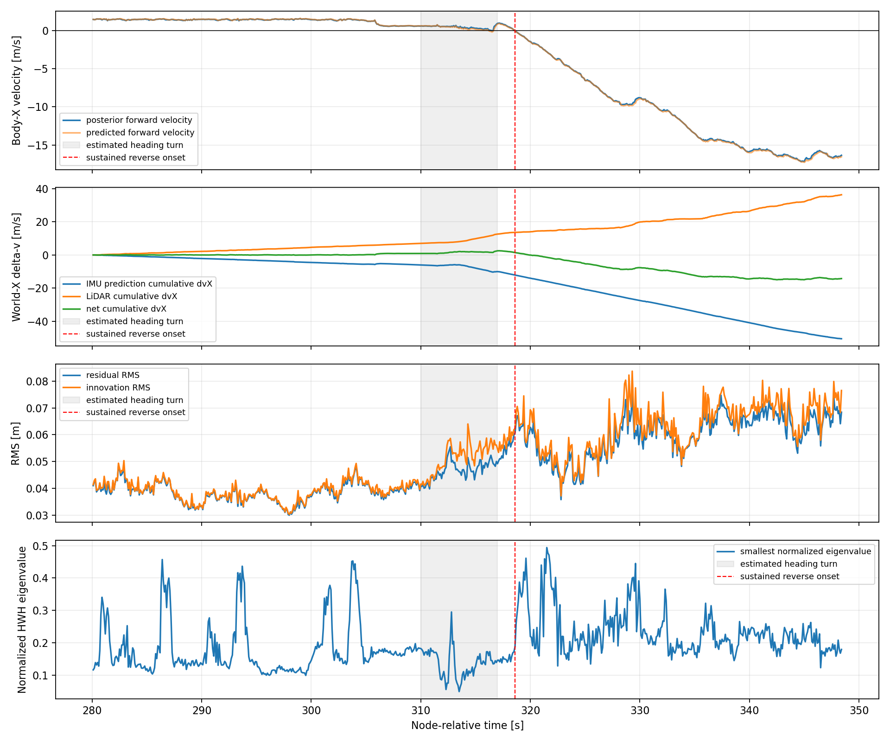
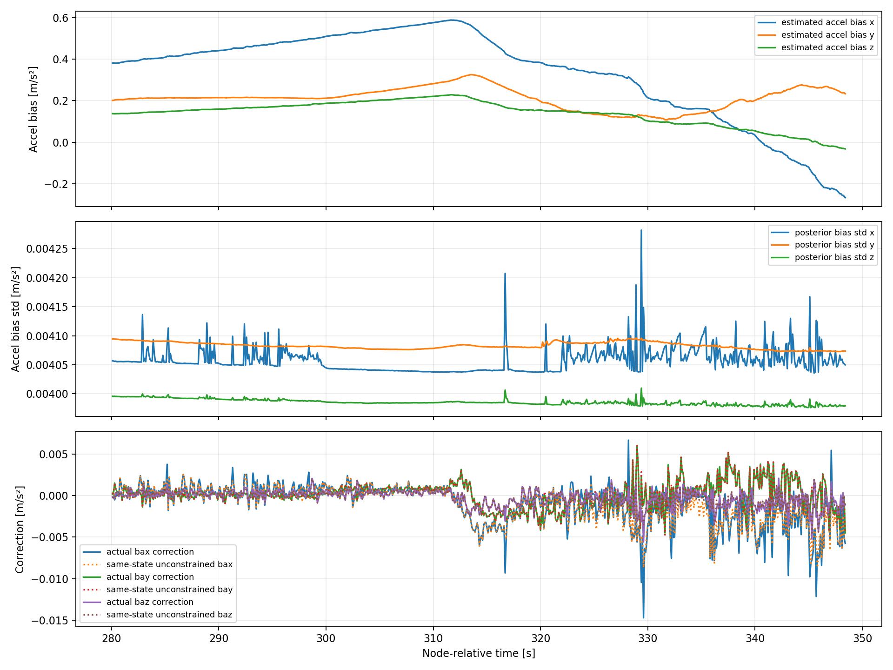

# 2回目のUターン：途中停止ログの分析（2026-09-27）

348.4秒で停止した今回のログから、発散前後を分析できた。
継続的な後退の開始は **318.59985秒**。このスキャンではIMU予測が先に速度を負にし、
LiDAR更新が戻す方向に働いても回復できなかった。
その後も負方向の予測速度変化をLiDAR補正が打ち消しきれず、348.4秒には機体前方速度が−16.36 m/sとなった。
これはログに記録された推定の挙動で、実機の真の速度ではない。

## 対象と記録の完全性

- 元run: `humble_ws/src/fast-livo2/Log/diagnostics/run-1790502604762878662-0/`。
- 保全コピー: `/tmp/fast-livo2-uturn2-hhrpwvwg/`。同時刻の `mat_pre.txt`, `mat_out.txt`, `imu.txt`,
  `xicp_diagnostic.csv` もコピーし、[manifest](diagnostics/uturn2_20260927/manifest.json)にSHA256を記録した。
- LIO-only、X-ICP有効、gravity固定・bias推定有効。前回360秒検証のROSパラメータとの差は、
  [診断時間帯と保存先だけ](diagnostics/uturn2_20260927/parameter_comparison.json)。再生倍率はメタデータに含まれず未確認。
- 3.299206–348.399713秒の **3,452スキャン、13,648反復**。全スキャンが`updated`、非有限値なし。
- 詳細は300.099480–348.399713秒の **484スキャン、1,932反復、3,770,399対応点**、約1.63 GB。
  350秒までの未記録部分はあるが、停止までの対応点は揃っており再構成検査に合格した。
- 補正恒等式の最大絶対誤差3.89e-16、制約補正誤差2.50e-16、共分散の最小固有値約1e-8。
  これらは記録と数値計算の整合性を示し、推定精度の保証ではない。
- IMU積分入力ログ **69,062行すべて**が、前回360秒・診断OFF実行の先頭同区間と完全一致。
  スキャン時刻とraw点数も3,452行で一致した。積分ログの最大間隔は約8.34 ms、10 ms超なし。
  今回は独立した受信監視ログがないため、この値は処理済みIMUの記録時刻に基づく。

## 反転と速度変化

後退開始は、機体前方速度が20スキャン連続で負になる最初の時刻とした。
world-Xの符号だけで前進・後退を判定していない。

| ノード時刻 | 機体前方速度 [m/s] | 推定IMU pitch [deg] | 推定accel biasノルム [m/s²] |
|---|---:|---:|---:|
| 300.0 | +1.418 | 23.637 | 0.583 |
| 310.0 | +0.583 | 25.142 | 0.678 |
| 320.0 | −1.442 | 14.538 | 0.457 |
| 327.0 | −8.597 | 13.384 | 0.375 |
| 337.0 | −14.326 | 11.904 | 0.204 |
| 348.4 | −16.357 | 10.631 | 0.356 |

318.59985秒の前方速度は、前スキャン終了時 **+0.06528** → IMU予測 **−0.07330** →
LiDAR更新後 **−0.04380 m/s**。この最終反復は6方向すべてFULL、制約0件、対応点1,480件。
初反転時のLiDARゲインは同じ状態での無制約ゲインと一致する。

ターン後のworld-Xは進行方向に近い。各区間の速度変化を
「前の更新後→次のIMU予測」と「IMU予測→LiDAR更新後」に分解すると:

| 区間 [s] | IMU予測の累積ΔvX [m/s] | LiDAR補正の累積ΔvX [m/s] | 合計 [m/s] |
|---|---:|---:|---:|
| 315–320 | −6.078 | +4.171 | −1.907 |
| 320–325 | −6.887 | +1.636 | −5.251 |
| 325–330 | −6.562 | +4.226 | −2.336 |
| 330–337 | −9.499 | +4.117 | −5.382 |

LiDARは区間累積では前方へ戻しているが、予測側の減速が大きい。
個々のスキャンで常に同じ補正方向になるという意味ではない。



## Uターン前後で変わった加速度の釣り合い

IMU予測式 `a_W = R * (s * a_IMU - b_a) + g` を使い、記録されたIMU区間平均、
推定姿勢、推定biasから近似再構成した。ここではworld-Xの平均を示す。

| 区間 [s] | `R*s*a_IMU + g` [m/s²] | `-R*b_a` [m/s²] | 再構成の和 [m/s²] | 実際の予測ΔvX/Δt [m/s²] |
|---|---:|---:|---:|---:|
| 300–310 | −0.712 | +0.569 | −0.142 | −0.150 |
| 315–320 | −0.759 | −0.458 | −1.217 | −1.215 |
| 320–325 | −0.982 | −0.386 | −1.367 | −1.378 |

Uターン前には打ち消し合っていた項が、ターン後は両方とも負方向になっている。
推定姿勢・biasと、重力補償を含むIMU予測の釣り合いが崩れる機構を今回も再現した。
前段では、180–310秒の推定pitch変化のうちIMU予測が+4.918°、LiDAR更新が+0.615°。
同区間のaccel bias変化はLiDAR更新で生じ、X/Y/Zそれぞれ+0.6361/+0.2809/+0.2534 m/s²だった。

再構成は各IMU時刻の厳密な伝播姿勢ではなく次スキャンの推定姿勢・biasを使う近似。
スケールは同じ入力を使った前回初期化の `s=9.81/0.9997`、重力は `[0,0,-9.81]` とした。
上記の和が実際の予測加速度に近いことを確認している。
ただし、推定IMU pitchには取り付け角が含まれ、走行中の加速度も姿勢の真値にはならない。
この再構成だけで実センサーbiasの変化や姿勢誤差の真値を確定することはできない。

## 残差・ゲイン・共分散・結合ヘッセから分かったこと

各スキャンの採用された最終反復を集計した。

| 区間 [s] | 残差RMS中央値 [m] | 列正規化した6×6ヘッセの最小固有値中央値 | 実際の累積ΔvX補正 [m/s] | 同じ状態での無制約補正 [m/s] |
|---|---:|---:|---:|---:|
| 300–310 | 0.0397 | 0.175 | +2.367 | +2.367 |
| 315–320 | 0.0525 | 0.157 | +4.171 | +4.016 |
| 320–325 | 0.0490 | 0.219 | +1.636 | +2.215 |
| 330–337 | 0.0599 | 0.204 | +4.117 | +5.477 |
| 337–348.4 | 0.0664 | 0.206 | +12.343 | +12.429 |

- **残差は増えている。** ただし局所的な点―平面整合の値であり、位置や地図全体が正しいことを保証しない。
- **ヘッセの情報が全方向で消失した形ではない。** 最小固有値は反転後も有限・正である。
  正規化した単一スキャンのヘッセから時間的可観測性や正しい対応付けまでは判断できない。
- **ゲインは残っている。** 315–320秒の速度Xゲイン行ノルム中央値は0.154、accel bias Xは0.00470。
  320–325秒と330–337秒ではX-ICPが同じ事前・対応点での前方への補正を小さくする影響も見える。
  これは同一反復状態での比較で、別の無制約軌跡を再生した結果ではない。
- **共分散は小さいまま。** 300–348秒のaccel bias事後標準偏差は各軸およそ0.004 m/s²。
  停止時の速度事後標準偏差も約0.009–0.015 m/sである。
  観測された大きな推定の崩れに対し、不確かさが増えていない点は、モデル・地図相関を含む過信を疑う材料になる。
  正解軌跡がないため統計的な不整合量の確定や、共分散設定だけを原因とする断定はできない。



## 次に切り分けること

停止前のデータだけで反転機構と数値整合性を調べられたため、360秒へ延ばすだけの再実行は不要。
残る課題は、ターン前から蓄積した姿勢・biasのずれが、地図変形・誤対応、共分散／相関モデル、
実センサー特性のどれから始まったかの切り分けである。
次は180–220秒の集計と、310–325秒の詳細を使い、rawスキャンと局所地図の平面・対応点を照合する。
今回のCSVには対応点の完全な位置・地図IDがないため、この照合には追加の地図・対応関係の情報が必要。
推定式・較正・gravity/bias設定は今回変更していない。

記録による処理タイミングの変化とikd-tree再構築の非決定性は残る。
IMU入力が一致していても、前回との後退時刻差を診断ON/OFFの精度効果と解釈しない。

## 保存結果と再解析

- [数値・記録の整合性](diagnostics/uturn2_20260927/integrity_summary.json)
- [反転・ゲイン・加速度分解の集計](diagnostics/uturn2_20260927/uturn_summary.json)
- [全区間の共分散図](diagnostics/uturn2_20260927/covariance.png)、[ゲイン図](diagnostics/uturn2_20260927/gains.png)
- [解析スクリプト](diagnostics/uturn2_20260927/analyze_uturn.py)

リポジトリ直下から:

```bash
PYTHONNOUSERSITE=1 OPENBLAS_NUM_THREADS=1 python3 \
  humble_ws/src/fast-livo2/scripts/analyze_lio_diagnostics.py \
  /tmp/fast-livo2-uturn2-hhrpwvwg/diagnostics \
  --output /tmp/fast-livo2-uturn2-hhrpwvwg/analysis --plot

PYTHONNOUSERSITE=1 OPENBLAS_NUM_THREADS=1 python3 \
  docs/diagnostics/uturn2_20260927/analyze_uturn.py \
  /tmp/fast-livo2-uturn2-hhrpwvwg \
  --reference /tmp/fast-livo2-diagnostics-2dbp5e9q/long-off \
  --output /tmp/fast-livo2-uturn2-hhrpwvwg/uturn
```

`--reference` はIMU入力の比較先で、省略可能。
元の通常Logは次の再生で上書きされるため、今回の分析には保全コピーを使う。
