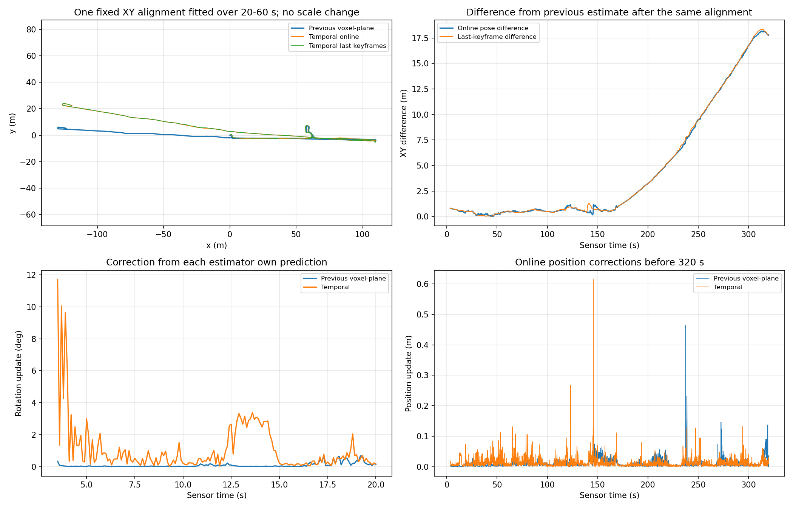

# 時間窓への変更による320秒以前の退行（2026-09-29）

初期化だけを復元した後の全走行結果は[追補分析](TEMPORAL_POST_INIT_ANALYSIS.md)に記録した。
初期方位と前半の一部は改善しており、以下は初期化復元前の比較として読む。

**時間窓への変更で、320秒以前から従来より全区間の地図・軌道精度が大幅に悪化した、というユーザーの指摘を評価の前提とする。**
「後退は解消し、精度の問題が残る」という整理は不十分だった。320秒後の速度符号や階段付近に調査を限定せず、変更直後からの退行として扱う。

今回、時間窓導入直前のvoxel-plane実行と対象実行の保存状態を比較した。初期化直後の大きな姿勢補正、直進区間の位置補正の増加、320秒以前の軌道形状の差を確認した。RVizの表示履歴の問題だけではない。

## 比較条件

- 従来：`lio-reconstruction-20260928-093848-xfyj5zxg`の保存snapshot。
  元captureディレクトリは現在一覧にないが、`voxel-plane-analysis-20260928/data`の状態・IMU・設定は保存manifestのSHA256と一致する。
- 時間窓：`lio-reconstruction-20260928-113320-mx5y2ada`。
- 同じraw bag、LIO-only。320秒未満の同時刻3,166スキャンを比較。時刻差最大約5×10⁻¹⁰秒。
- 処理IMUの共通先頭66,582行は、時刻と全測定成分が完全一致。
- `common`、`extrin_calib`、`imu`、`preprocess`、`uav`の実効設定に差なし。
  再生速度や推定器内部の処理は異なるが、初期化時間・外部較正・IMU雑音設定の変更を原因としては扱わない。

従来の推定にも誤差があり、絶対的な真値ではない。以下では「推定器間の差」と「真の位置誤差」を区別する。
これはユーザーの比較結果を否定するためではなく、ログから立証できる範囲を明確にするためである。

## 1. 初期化直後から更新量が大きく変わっている

いずれも、それぞれの推定器のIMU予測から最新の更新後状態までの補正量。時間窓では他時刻の状態も更新するため、LiDAR単独の寄与を抽出した数値ではない。

| 区間・指標 | 従来のvoxel-plane | 時間窓 |
|---|---:|---:|
| 3.499–10秒：姿勢補正ノルムの95%点 | 0.0494° | **5.5789°** |
| 同区間：姿勢補正の最大値 | 0.3449° | **11.7024°** |
| 10–20秒：姿勢補正の95%点 | 0.5498° | **3.0135°** |
| 20–60秒：位置補正ノルムの95%点 | 0.0123 m | **0.0442 m** |
| 20–60秒：位置補正の最大値 | 0.0272 m | **0.1128 m** |
| 60–140秒：位置補正の最大値 | 0.0345 m | **0.2671 m** |

時間窓側は、従来の最初の更新より前の3.400秒にも約12.717°の姿勢補正がある。
さらに145.700秒には一度に0.614 mの位置補正がある。これは320秒後の発散でも、480秒以降の階段だけの現象でもない。

一方、全ての区間・全ての補正指標が一律に増加しているわけではない。例えば220–300秒の位置補正最大値は従来側の方が大きい。
補正量単独で精度を判定せず、初期の状態変化と後続の軌道形状を合わせて評価する。

## 2. 初期方位の違いだけでは説明できない軌道の差

同時刻の姿勢差は10秒で5.159°、20秒で12.599°、60秒で14.381°。
この大部分はyawの差であり、単純に同じworld座標で位置を引くと、座標系の方位差も距離差に含まれる。

その影響を減らすため、**20–60秒だけ**を使って水平面の回転・並進を一度だけ合わせ、同じ変換を全区間へ適用した。
スケール変更、時刻補正、区間ごとの再整列、全区間を使った後合わせはしていない。
合わせたyawは−14.383°、同区間の水平位置差RMSは0.325 m。

| 時刻 | 整列後の水平位置差：オンライン最新姿勢 | 整列後の水平位置差：最後に記録されたキーフレーム |
|---|---:|---:|
| 約60秒 | 0.488 m | 0.540 m |
| 約180秒 | 1.617 m | 1.630 m |
| 約220秒 | **5.279 m** | **5.327 m** |
| 約260秒 | **10.882 m** | **10.916 m** |
| 約300秒 | **16.760 m** | **16.754 m** |

右列は近傍のキーフレーム時刻で、従来軌道を時刻補間して比較した値。
オンライン出力と修正済みキーフレームの両方に同程度の差がある。
したがって、既に直した `/path` の修正履歴混在だけでは、この差を取り除けない。
約16.8 mを真値に対する誤差と断定はしないが、初期方位の違いだけでは説明できない形状変化を示している。



## 3. 時間窓だけを追加した変更ではなかった

現在の時間窓経路は、既存のLIVO voxel-plane地図・更新処理の上へ時間的拘束だけを追加したものではない。
`handleLIO()`は時間窓が有効なら早期returnし、従来の地図初期化と観測更新を通らない。

| 処理 | 従来のvoxel-plane経路 | 現在の時間窓経路 |
|---|---|---|
| 地図初期化 | 複数スキャンを蓄積し、点数・面数・法線方向の情報量を確認 | 最初の1スキャンを登録し、次スキャンから最適化 |
| 実測された初期地図 | 3スキャン、15,791点、625面でREADY | 同じ初期化判定を通らない |
| LiDARの参照先 | これまでの観測を蓄積したLIVO voxel-plane地図 | 直前の保持キーフレーム1枚 |
| 面推定・不確かさ | 既存のvoxel/octreeと面・点の共分散処理 | スキャン内PCAと独自の分散・支持点数上限 |
| 更新と退化処理 | IEKF＋X-ICP | 全状態QR最適化。従来X-ICP更新を使用しない |
| 非キーフレームの観測 | 地図へ蓄積 | 次スキャン更新後に周辺化し、非線形な再対応は終了 |

コード上の差は確定している。一方、初期化・参照地図・面モデル・最適化の各変更が誤差をどれだけ生んだかは、同時に変更したため現ログだけでは分離できない。
**初期から退行しているという指摘に対しては、まず地図初期化と観測処理の置換を優先して切り分ける。**
時間窓の長さや階段用の閾値だけを調整する方針にはしない。

関連実装：`LIVMapper.cpp`の`handleLIO()`、`voxel_map_initialization.cpp`の`TryInitializeVoxelMap()`、
`temporal_window.cpp`の`Window::add()`、`temporal_planes.cpp`の`refresh()`。
前回指摘した歪み補正Jacobian・周辺化との整合性も検証対象だが、初期化・参照地図の変更を飛ばしてそれだけに原因を絞らない。

## 4. 対策・合否判定の修正

1. **最初の比較を0–60秒へ戻す。** 共通入力で初期参照面の数・方向別情報、初期姿勢と世界座標の基準、各因子の補正寄与を記録する。
   従来の複数スキャンによる初期化を使う場合と、現在の単一スキャン初期化を使う場合を個別に比較し、因果関係を確かめる。
2. **既存の観測処理を置き換えた影響を分離する。** LIVO voxel-planeの蓄積・品質評価を活かす経路と、直前1枚への照合を比較する。
   時間窓へ渡す際は、面の取得姿勢と不確かさを持たせる。従来IEKFの事後状態を独立な観測としてさらに投入し、同じIMU/LiDARを二重計上する構成にはしない。
3. **180–300秒で形状の退行が再発しないことを確認する。** 初期方位を揃えた相対軌道、往復の形状、位置・姿勢の更新量、姿勢・速度・biasの整合を評価する。
4. **その後に320秒後と階段・全走行を判定する。** 前半の精度を壊して後退だけを止める結果は不合格。

今回の作業は既存記録の比較と方針の訂正。推定コード・設定・バイナリは変更していない。
新しい現地収録は不要。各要因を個別に切り替える検証には、保存済みraw bagの再生を使用する。

## 記録と再現

数値・入力照合結果：[comparison.json](diagnostics/temporal-early-regression-20260929/comparison.json)。
原captureと保存snapshotは読み取り専用で扱った。

```bash
python3 docs/diagnostics/temporal-early-regression-20260929/analyze.py \
  diagnostic_captures/voxel-plane-analysis-20260928/data \
  diagnostic_captures/lio-reconstruction-20260928-113320-mx5y2ada \
  --output /tmp/temporal-early-comparison
python3 docs/diagnostics/temporal-early-regression-20260929/plot.py /tmp/temporal-early-comparison
```
