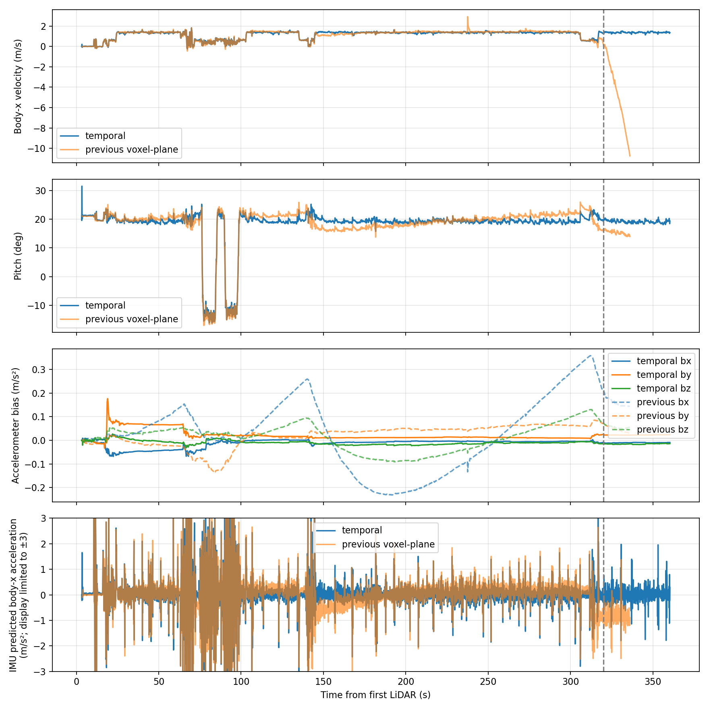

# 時間窓推定の検証結果（2026-09-28）

**今回のbagでは、時間窓経路で360.299秒まで完走し、320秒付近のUターン後に起きていた持続的な後退を再現しなかった。** 推定速度だけでなく、出力位置の差分も前進を示している。

実装と実行方法は[TEMPORAL_LIO.md](TEMPORAL_LIO.md)。独立した真値との位置精度評価ではないため、一般的な「根治完了」までは主張しない。

**2026-09-29更新:** 後続の全648秒実行について、ユーザーから時間窓への変更により従来より全区間で地図・軌道精度が大幅に悪化したと報告された。方式変更の退行であり、後退がなくなったという指標だけで改善と評価しない。
ログから、履歴修正が混在する軌道出力の不具合と、推定器自体の大きなz補正の両方を確認した。
出力・RViz設定は修正し、短い再生で推定値が不変なことを確認済み。全体精度の対処は未完了。
次の比較方針・数値は[全区間の品質分析](TEMPORAL_QUALITY_ANALYSIS.md)を優先する。
その後の[320秒以前の比較](TEMPORAL_EARLY_REGRESSION.md)で、初期化直後の大きな姿勢補正と、
初期方位を揃えても180–300秒に拡大する軌道形状の差を確認した。以下の後退回避の指標だけでは合格としない。

## 実データの比較

同じ`bags/raw_20260907_114335`を先頭から使用。時間窓はLIO-only、6秒、最大16状態、3反復。再生は0.3倍速。従来比較は前回のclean voxel-plane＋X-ICP実行（0.5倍速）。

| 指標 | 従来のvoxel-plane＋X-ICP | 時間窓経路 |
|---|---:|---:|
| 321.100秒のbody-x速度 | −0.062 m/s | +1.411 m/s |
| 335.999秒のbody-x速度 | −10.745 m/s | +1.327 m/s |
| 320–325秒の平均body-x速度 | −0.978 m/s | +1.379 m/s |
| 325–336秒の平均body-x速度 | −6.259 m/s | +1.374 m/s |
| 325–336秒の平均IMU予測加速度・body-x | −0.802 m/s² | +0.031 m/s² |
| 220–310秒のaccel bias x増分 | +0.51394 m/s² | −0.00019 m/s² |
| 220–310秒のpitch変化 | +3.562° | −0.085° |

時間窓経路では、325–336秒の出力位置差分をbody-xへ投影した平均速度も+1.359m/s、最小でも+1.093m/sだった。336–360秒も推定速度平均+1.374m/s、位置差分平均+1.369m/s。318秒以降にbody-x速度が−0.05m/sを下回ったスキャンはない。

body-xはIMUの取り付け傾斜を含む成分で、前回解析と同じ定義。単発の予測加速度には振動・加減速が残るが、従来のような持続する後退加速度になっていない。



数値は[comparison.json](diagnostics/temporal-lio-20260928/comparison.json)、全期間の集計は[summary.json](diagnostics/temporal-lio-20260928/summary.json)。

## 完全性・処理負荷

- 3.199–360.299秒の3,572スキャン。初期登録1回、対応あり更新3,571回。`imu_only`への移行なし。
- 最大保持13状態、最大時間幅5.999999秒。全共分散が有限・正定値。最小固有値は約1.31×10⁻⁶。
- 処理時間は中央値184.9ms、95%点208.0ms、最大356.5ms。等速10Hzを満たさないので、利用時は0.25倍速を推奨する。
- IMU最大間隔は約8.35ms。captureは`integrity: ok`、node/player/monitorすべて正常終了。
- IMU受信時刻72,059件を元bagの該当区間と照合した。受信開始・終了間の欠落なし。
- 推定器が処理したIMU測定値71,442行を元bagの連続する中点平均と照合した。前回実行と共通する66,582行も全列完全一致。

入力検証は[imu-comparison.json](diagnostics/temporal-lio-20260928/imu-comparison.json)、終了記録は[capture-summary.json](diagnostics/temporal-lio-20260928/capture-summary.json)。IMU monitorの受信数だけを、推定器の欠落なしの根拠にはしていない。

capture:

```text
diagnostic_captures/temporal-validation/lio-reconstruction-20260928-103605-kvnl2o13
```

## 実装の回帰検証

CTest 7/7、capture関連Pythonテスト18/18が成功した。合成テストには、180度を超える旋回での両bias回復、座標系変換、非identity外部較正での歪み補正、100秒間の無観測、床・平行壁だけの廊下、周辺化と全状態保持の共分散比較を含む。

時間窓OFFの3.499–24.999秒の216スキャンについて、状態出力が前回と完全一致した。IMU処理記録4,380行も完全一致。従来経路の比較を維持できている。

[CTest記録](diagnostics/temporal-lio-20260928/ctest.txt)、[Python試験](diagnostics/temporal-lio-20260928/capture-tests.txt)、[OFF比較](diagnostics/temporal-lio-20260928/disabled-comparison.json)。

### 検証バイナリと最終ビルドの区別

360秒の連続再生バイナリは`05ceab6b…`。その再生中に、スキャン間隔より短い窓を設定した場合にも時間幅上限を守るため、周辺化の終了条件を「最低2状態」から「最低1状態」へ修正した。通常6秒設定では、この変更によって追加の状態が削除される場面はない。

最終install済みバイナリは`adc6eb8c…`。別の先頭20秒再生は正常終了し、連続再生と比べた状態の最大絶対差は4.49×10⁻⁸、共分散は6.11×10⁻¹⁰で、丸め誤差の範囲だった。短い窓の境界条件はC++テストでも確認済み。

完全なSHA256と記録の対応は[build-validation.json](diagnostics/temporal-lio-20260928/build-validation.json)、照合詳細は[final-binary-parity.json](diagnostics/temporal-lio-20260928/final-binary-parity.json)。

## 結果の解釈と残る範囲

前回の「姿勢と加速度biasの不整合が増え、ターン後にIMU予測が持続的な後退加速度を持つ」という経路は、この実行では抑制された。時間をまたぐ状態拘束と、取得姿勢に応じた面の再評価を主対策へ移す方針を支持する結果である。

ただし今回は、同時推定・局所面の再生成・観測重み・従来X-ICP更新の除外を含む経路全体の比較であり、個々の変更の寄与を分離した実験ではない。全履歴BA、共有面の完全な相互共分散、他bag・Jetsonでの速度検証、独立真値に対する精度評価は残る。

初期数スキャンには大きめの姿勢補正がある（約3.4秒にpitch約31.6°、約3.5秒で約20.6°へ戻る）。初期priorの姿勢分散を引き継いだ短い窓の挙動で、今後の初期化評価対象とする。今回の検証を理由に姿勢・biasの初期分散を無検証で締め付けていない。

次はこの設定でRViz上の軌跡・点群を確認し、別の記録でも再現性を評価する。窓長・観測数・処理速度の調整は、この結果を基準に一項目ずつ比較する。

## 通常スクリプトの起動確認と重複ノード対策

`110428-q53d2ovk`の起動失敗を調査したところ、ROSドメイン42に`093848-xfyj5zxg`の
旧`/laserMapping`（コンテナPID 114）が残存していた。実行中の`/proc/114/exe`のSHA256は
`0b6627da…`で旧captureと一致し、ディスク上の新バイナリ`adc6eb8c…`とは異なる。
新ノードのログには時間窓有効の記録がある一方、dumpには`lio.temporal.*`が全て欠けていた。
同名ノードのパラメータサービス競合に整合し、再ビルド不足を示す失敗ではなかった。

`reconstruct_raw.sh`は起動前にdaemonを使わずノード一覧を確認し、同名ノードが存在する場合は
プロセス起動・capture作成前に停止する。パラメータ不一致にも実測値・期待値・同名ノード確認の案内を追加した。
再実行は未使用の`FAST_LIVO2_RECONSTRUCTION_DOMAIN_ID`を指定する。推定コード・バイナリは変更していない。

通常の`reconstruct_raw.sh`からdomain 43、rate 0.25で先頭20.500秒まで再生した。
実際のlaunch・推定器・bag player・IMU monitorを使用し、RViz表示だけ待機プロセスに置き換えた。
実効パラメータ検証成功、174スキャン（初期登録1・更新173）、IMU監視4,101件、`capture_integrity=ok`。
20秒到達後のSIGINTで終了し、終了処理も成功した。GUI表示の確認は含まない。
同じ試験ノードの稼働中に別の起動を試み、captureを作成せず拒否することも確認した。

[起動試験記録](diagnostics/temporal-lio-20260928/startup-validation.json)、
[重複起動拒否](diagnostics/temporal-lio-20260928/startup-duplicate-check.txt)、
[Python 19/19成功](diagnostics/temporal-lio-20260928/startup-capture-tests.txt)。

## ROS CLI daemon障害への対応

`112549-f5s58s1e`の`effective parameter dump unavailable`は前項の同名ノード競合とは別の失敗。
`param_dump.stderr`には、ROS CLI daemonのノード一覧取得がXML-RPC経由で
`xmlrpc.client.Fault: ... !rclpy.ok()`を返した記録がある。新ノードは時間窓を有効にして正常に起動していた。
調査時もユーザーのdomain 42で通常の`ros2 node list`は同じエラーを返し、
`--no-daemon --spin-time 2`を付けると正常終了した。

前項の修正は起動前のノード一覧取得だけを直接問い合わせにしており、dump側にはdaemon依存が残っていた。
`reconstruct_raw.sh`と`validate_temporal_replay.py`のdumpにも`--no-daemon --spin-time 2`を追加。
取得上限は発見・パラメータ全件取得を含め15秒とした。
shell側は失敗時に理由の末尾を表示し、各試行の標準エラーと終了コードを追記保存する。
推定器・YAML・バイナリは変更していない。

daemon障害を模擬する試験を含め[Python 20/20成功](diagnostics/temporal-lio-20260928/daemon-capture-tests.txt)。

ユーザーコンテナとネットワークを共有する試験コンテナで、同じ不調daemonが残るdomain 42を使用して実再生した。
通常の`reconstruct_raw.sh`、rate 0.25で12.200秒まで処理（初期登録1・更新90）、`capture_integrity=ok`。
直接dumpは1回目で成功。試験前後ともdaemon経由の一覧取得は同じ`!rclpy.ok()`で失敗しており、
daemonを再起動して成功させた試験ではない。既存Logは別mountで保護し、RViz表示のみ待機プロセスで代替した。
推定時刻12秒到達後にSIGINTで終了、関連プロセスも終了。試験コンテナは削除済み。
[実行記録とエラー原文](diagnostics/temporal-lio-20260928/daemon-validation.json)。
