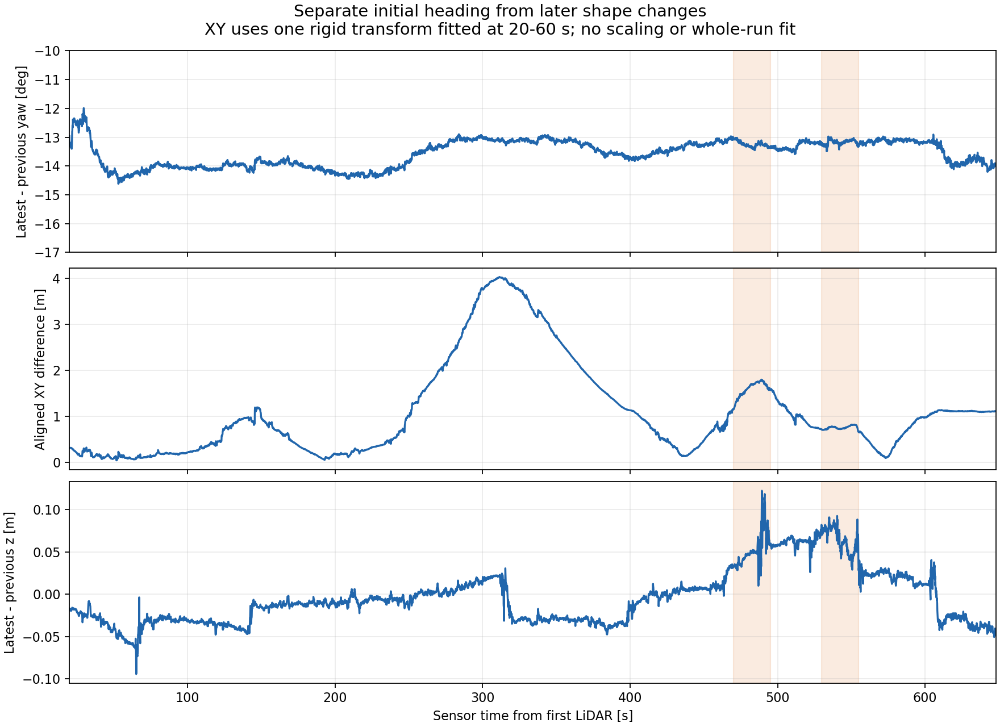
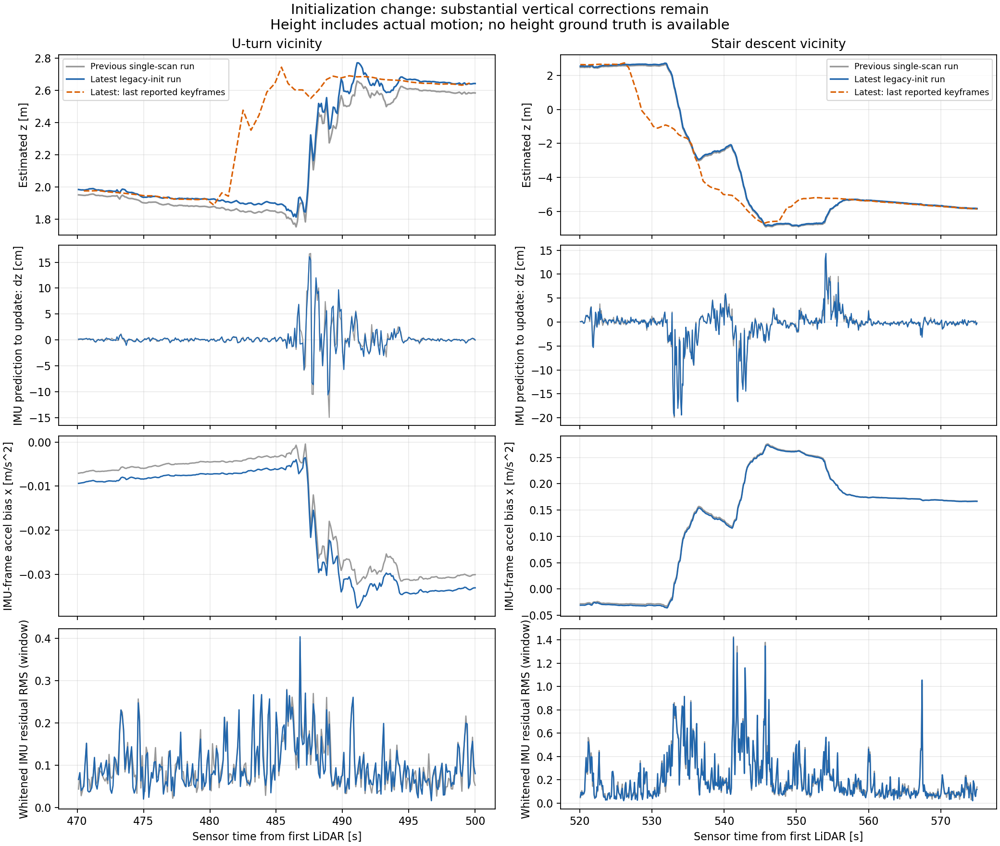

# 初期化復元後に残る yaw・高さの問題（2026-09-29）

初期化を `legacy_voxel` に戻した全走行では、初期方位と前半の軌道形状に改善がある。
一方、Uターン・階段付近の大きな高さ補正と、過去姿勢の大幅な再修正はほぼ変わらない。
次は初期化以降の観測モデル・最適化の整合性を直す段階である。
時間窓で姿勢・速度・両biasを同時推定する方針そのものの失敗とは、まだ判断できない。

## 対象と保存状態

| 対象 | capture | 初期化 |
|---|---|---|
| 旧時間窓 | `lio-reconstruction-20260928-113320-mx5y2ada` | `single_scan` |
| 今回 | `lio-reconstruction-20260929-080320-g0vyyobv` | `legacy_voxel` |

- 今回は648.100秒まで6,448スキャンを保存し、終了後の `capture_integrity` は `ok`。
  IMU監視も完了。旧captureは終了summaryがないが、比較に使うCSVの行・有限性・時刻順序を確認した。
- 両captureの処理IMU **129,004行は全列完全一致**。共通6,448スキャンの時刻も完全一致。
  処理IMUの最大間隔は10.669 msで、20 ms超の欠落を原因とする証拠はない。
- 今回の推定器ソースはcaptureの保存manifestと一致。バイナリSHA256は
  `27baf23ed5c5c36e2f943b79b96a279433461bdafebd579f8137023353746bac`。
- 実効パラメータの差は保存先と初期化モード。ただし旧実行からは `/path` 履歴の修正や
  累積地図表示の復元も入っており、**RViz画面だけを初期化の一変数比較とは扱わない**。
- 元captureは読み取り専用で解析。新しいbag再生や推定器の変更はしていない。

## 改善した部分と、変わらない部分

### 初期方位と前半の軌道

時間窓導入前のIEKF voxel-plane実行の保存snapshotとも比較した。
20–60秒のXYだけで回転・並進を一度合わせ、スケール変更や全区間での後合わせはしない。

| 従来IEKFに対する比較 | 旧時間窓 | 今回 |
|---|---:|---:|
| 初期区間を合わせる水平回転角 | −14.383° | +0.321° |
| 整列後の260秒の水平位置差 | 10.882 m | 9.345 m |
| 整列後の300秒の水平位置差 | 16.760 m | 13.019 m |
| 320秒以前の最大の位置補正 | 0.614 m | 0.317 m |

初期方位だけでなく、前半の一部の軌道形状・大きな補正も改善している。
従来IEKFも真値ではないため、これらを絶対的な位置誤差とは呼ばない。
初期化直後の姿勢補正は依然大きいが、前回の短時間評価だけで今回の全走行改善を否定するのは不適切。
`/path` の修正済みキーフレームと未修正の中間姿勢を混在させない変更も、ギザギザの軽減に寄与する。

今回と旧時間窓のyaw差は、多くの区間で約−13～−14°。
この大きな一定方位差と、その後の相対的なyawドリフトを分けて評価する必要がある。
重力だけでは絶対方位を決められず、二つの推定器のyaw差をそのまま真の方位誤差とはできない。
初期方位を合わせても300秒の両時間窓推定間の水平差は約3.76 mあり、全てが一定回転の違いでもない。



### Uターンと階段の高さ

「一回のz補正」は、そのスキャンのIMU予測から時間窓更新後の最新状態までの差。
LiDAR単独の寄与や真値に対する誤差ではない。

| 指標 | 旧時間窓 | 今回 |
|---|---:|---:|
| 470–495秒：一回のz補正の最大絶対値 | 16.72 cm | 16.09 cm |
| 530–540秒：一回のz補正の最大絶対値 | 19.93 cm | 19.58 cm |
| 540–555秒：一回のz補正の最大絶対値 | 16.43 cm | 16.66 cm |
| 530–540秒のキーフレーム：初回から最後までの高さ修正の最大値 | 3.747 m | 3.739 m |

520–575秒の新旧オンライン高さの差はRMS 5.46 cm、最大9.26 cm。
つまり、階段付近の大きな上下変動はほぼ同じ波形で残っている。

今回の530.800秒のキーフレームは、最初に `z=2.63979 m` と推定された後、
窓内の再最適化で `z=−1.09874 m` へ修正された。同じ時刻の推定が **−3.73853 m** 変わったのであり、
階段を実際に3.74 m下った距離を指す数値ではない。
485.399秒のキーフレームも `1.89334→2.74386 m`、約+85 cmの修正がある。

533.100秒には一回で約−19.6 cmの高さ補正があり、530–550秒のIMU座標系加速度biasのx成分は
約−0.031から+0.261 m/s²へ変化する。姿勢が傾くとbody-x方向のbiasも世界座標z方向へ投影されるため、
`bias_z` だけを見る切り分けでは足りない。この変化だけで真のbias変動か誤差の吸収かは決まらない。

530–540秒のLiDAR残差RMSの中央値は約3.0 cm、対応数の最小値も916ある。
それでも上記の修正が出ている。残差の小ささや対応数だけでは方向別の拘束の妥当性を保証できない。
全事後共分散は有限・正定値だが、それだけでモデルの正しさは検証できない。

階段では大きな回転・加速度も記録されるが、平地にも大きな加速度ピークがある。
振動の大きさだけを原因と断定しない。また、実際の下降やIMU取付角を含むため、
最終z値・区間内のz変動幅・pitch値そのものを全て誤差とは扱わない。



## 原因の整理

### 1. 再歪み補正とLiDAR因子が使う状態感度の違い：コードと独立probeで確認

[`temporal_planes.cpp`](../humble_ws/src/fast-livo2/src/temporal_planes.cpp) の `refresh()` は、
現在の姿勢・速度・両biasでraw点を再び歪み補正し、面・対応も作り直す。
一方、[`temporal_factors.cpp`](../humble_ws/src/fast-livo2/src/temporal_factors.cpp) のLiDAR因子は、
歪み補正した点と面を固定し、source/targetの各6自由度の姿勢・位置だけを微分する。
速度・両biasへはIMU因子経由の間接的な拘束があるが、歪み補正を通じた直接の感度は含まない。

固定平面と実装済み `deskew()` を使った独立の中央差分probeでも、次を確認した。
静止IMU、0.1秒前の点 `(3,1,−1)`、水平面 `z=−1`、差分幅 `1e−5` の例である。

| 変数 | raw点から歪み補正を再計算した残差の微分 | 現行の点を固定したLiDAR因子の対応列 |
|---|---:|---:|
| 世界座標の速度z | −0.100 | 0 |
| gyro bias x | +0.100 | 0 |
| gyro bias y | −0.300 | 0 |
| accel bias z | −0.005 | 0 |

右列はソース上の列の省略から分かる値で、privateな `linearize()` をprobeから直接測定した値ではない。
固定点の目的関数に対する微分式が誤りという意味ではなく、raw入力からの残差に含まれる感度を近似で省略している。
この例では速度zの1 m/sの変化が、端点の姿勢・位置を固定しても約10 cmの残差変化になる。
実データの約20 cmの補正が全てこの省略で起きたと立証したわけではない。

さらに [`temporal_window.cpp`](../humble_ws/src/fast-livo2/src/temporal_window.cpp) のline searchは、
同じ固定点・面・対応の内側目的関数で採否を決める。次の `refresh()` 後の目的関数の悪化は採否に入らない。
ログの `cost_before/after` の減少だけでは、再歪み補正を含む一連の更新の整合性を保証できない。
**急回転・縦揺れ時の高さ・姿勢・biasの不安定さに対する有力候補**として、最初に分離検証する。

### 2. 初期化以降は従来LIVOの蓄積地図・面共分散モデルではない：コード上の相違は確定

`legacy_voxel` が復元するのは地図初期化だけ。
以後は各新スキャンを**直前のキーフレーム1枚**へ照合する。
6秒の窓に複数のキーフレームがあっても、各スキャンが蓄積した局所地図全体を参照する実装ではない。
この構造では、旋回中の視野・重複の変化や、偏った法線方向の影響を受けやすい可能性がある。

現行PCA面には点数・面の散らばりのスカラー分散と、同じ面への重みの上限がある。
品質を全く見ていないわけではないが、法線と中心の不確かさ・支持領域・点の測距方向を扱う
従来LIVOの面共分散と同じではない。yaw・傾き・並進の結合した弱い方向を確認する必要がある。

現在保存される15次元の周辺情報行列にはIMUとpriorも入る。
これをLiDARだけの回転・並進結合6×6ヘッセ行列の代わりにして、幾何学的退化を断定してはいけない。
どの方向の観測が不足・過大評価されたかは今回のログだけでは確定できない。

### 3. 早い周辺化が再修正を制限する：増幅要因の候補

非キーフレームは次スキャンの最適化後に周辺化される。
通常約0.5–0.6秒おきのキーフレームは6秒窓に残るが、全rawスキャンを6秒間再評価できるわけではない。
急動作時の歪み補正・対応の近似が早い段階のpriorに取り込まれる可能性がある。
窓を単に長くするだけではこの点は解消しない。現時点では寄与を分離できていない。

### 4. 過去姿勢の修正が累積地図へ反映されない：地図・軌道の不一致を増幅する構造

[`LIVMapper.cpp`](../humble_ws/src/fast-livo2/src/LIVMapper.cpp) の `update_and_publish_map()` は、
その時点のworld点を累積voxelへ保存する。点に取得姿勢の所有情報を残さず、過去姿勢の更新時に再投影しない。
一方、現在の `/path` は修正されたキーフレーム姿勢を使う。
記録された約85 cm・3.74 mの過去高さ修正に地図が追従できないため、地図と軌道が異なる推定履歴になる。

これは表示だけでなく出力地図の構成の問題。ただし、推定器内部の高さ補正の原因そのものではない。
元のPointCloud2履歴を保存していないため、実地図の二重面の厚さをこの解析で測定したとは主張しない。

## 対処の優先順位

1. **歪み補正を含む残差と状態Jacobianを整合させる。**
   姿勢・位置・速度・両biasについて、取得時刻から再構成した残差と微分を有限差分で検証する。
   sourceだけでなくtarget側の点・面への依存も設計に含める。
   対応の点IDを固定した同じ目的関数でstepを評価し、再対応・面更新前後の変化は別に記録する。
   因子別の勾配、IMUの回転・位置・速度・bias別残差、priorの寄与も記録し、
   「何がzやbiasを動かしたか」を特定できるようにする。
2. **時間窓の中でLIVOの面品質評価と複数キーフレームの参照を扱う。**
   法線・中心の不確かさ、支持領域、測定点の分散から観測重みを作り、
   LiDARの回転・並進結合情報から弱い方向を判定する。回転と並進の単位の正規化も明示する。
   同じ点を複数の地図へ重複照合して独立観測と数えず、取得姿勢と共有面の相関を扱う。
   target姿勢はすでに同時推定するため、旧面共分散に含まれる姿勢不確かさを無条件で重ねない。
   旧IEKFの事後状態を追加因子として入れ、同じIMU/LiDARを二重計上する方式も避ける。
3. **旋回・階段では動作量・重複率に応じてキーフレームを選び、周辺化を遅らせる。**
   まず1、次に2を個別比較し、その後に適用する。保持数・計算量を制限し、priorの整合も確認する。
4. **修正済み姿勢から累積地図を再構成する。**
   キーフレーム／submapごとの局所点群と姿勢を保持し、姿勢更新時には古い寄与を外して再投影する。
   全走行の `/Laser_map` 表示・色・QoSなど、ユーザーが求める表示仕様は維持する。
5. 局所推定を安定させた後、残る長距離のyaw・高さドリフトに再訪・loop closureを検討する。
   時刻ずれ・外部較正・IMU雑音や振動のモデルも、残差の証拠に沿って個別に検証する。
   高さ固定や単なる軌道平滑化だけを根治としない。実際に階段を下りるので、無条件のz固定は不適切。

## 次の比較と必要なデータ

今回の保存データで、改善の範囲・残る現象・実装上の候補を整理できる。
各候補の因果的な寄与の確定には、追加診断と変更を一つずつ入れた**既存raw bagの再生**が必要。
現地で新たに収録する必要はない。

- 0–60秒：初期姿勢と大きな補正の退行がないこと。
- 180–300秒：初期方位を合わせた軌道形状・往復の整合・biasの挙動。
- 470–495秒、528–560秒：z補正、過去姿勢の再修正、因子ごとの寄与、面の方向別情報、地図面の重なり。
- 全走行：320秒後の後退を再発させず、前半を悪化させず、修正した姿勢で地図も整合すること。

状態・周辺化priorを復元できるチェックポイントがないので、再生は先頭から行う。
必要区間だけ診断量を増やせば保存容量は抑えられる。
絶対的なyaw・高さ誤差を数値化するには、既知の階高・再訪地点・独立な基準が必要。
現状の推定器間の差や補正量だけを真値誤差として採点しない。

## 解析の再現

成果物は [diagnostics/temporal-post-init-analysis-20260929](diagnostics/temporal-post-init-analysis-20260929/)。
`comparison.json`、`old-summary.json`、`new-summary.json` が入力一致・区間統計・ログhash、
`against-iekf.json` が導入前との比較、`capture-summary.json` が最新終了状態。
`deskew_sensitivity.cpp` と結果JSONは独立probe。NPZ中間データは大きいため `/tmp` にのみ置いた。

captureへ読み取り権限がある環境で、NumPy/PyYAMLを使う：

```bash
python3 docs/diagnostics/temporal-post-init-analysis-20260929/analyze.py \
  diagnostic_captures/lio-reconstruction-20260928-113320-mx5y2ada \
  diagnostic_captures/lio-reconstruction-20260929-080320-g0vyyobv \
  --output /tmp/temporal-post-init-analysis-20260929
python3 docs/diagnostics/temporal-early-regression-20260929/analyze.py \
  diagnostic_captures/voxel-plane-analysis-20260928/data \
  diagnostic_captures/lio-reconstruction-20260929-080320-g0vyyobv \
  --output /tmp/temporal-post-init-analysis-20260929/against-iekf
PYTHONNOUSERSITE=1 MPLCONFIGDIR=/tmp/temporal-post-init-analysis-20260929/matplotlib \
  python3 docs/diagnostics/temporal-post-init-analysis-20260929/plot.py \
  /tmp/temporal-post-init-analysis-20260929
```

probeは既存のtemporal静的ライブラリと同じEigen/native設定でコンパイルする。
実施環境ではDocker内の `/external` にrepoをread-only、`/work` に作業用ディレクトリをmount：

```bash
g++ -std=c++17 -O3 -march=native -fno-fast-math \
  -I/external/humble_ws/src/fast-livo2/include -I/usr/include/eigen3 \
  /external/docs/diagnostics/temporal-post-init-analysis-20260929/deskew_sensitivity.cpp \
  /external/humble_ws/build/fast_livo2/libfast_livo2_temporal.a \
  -o /work/deskew_sensitivity
/work/deskew_sensitivity > /work/deskew-sensitivity.json
```
