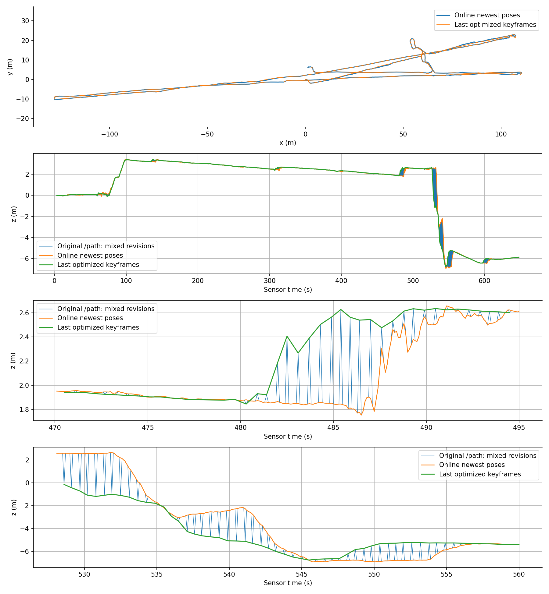
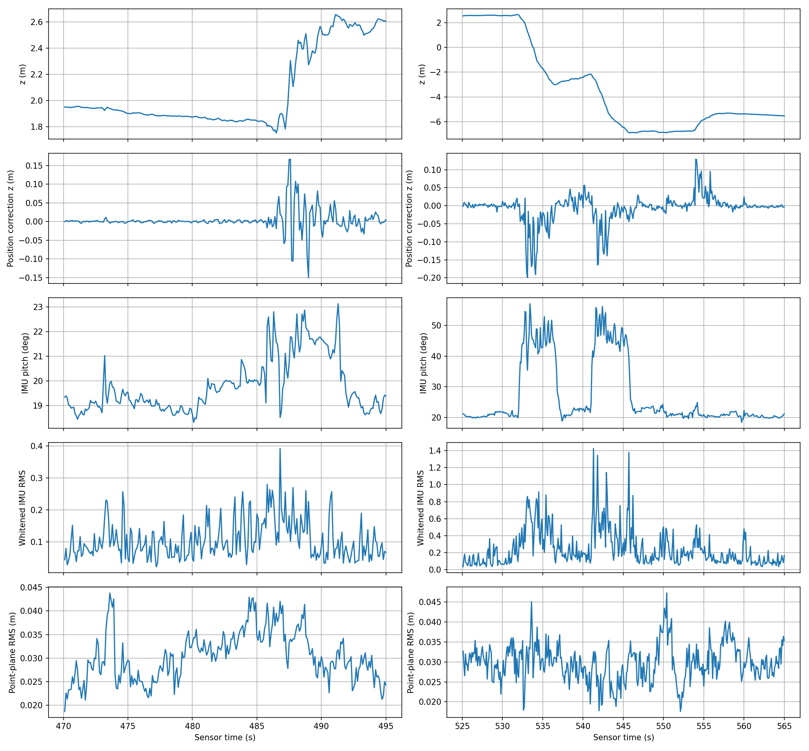

# 時間窓実行の軌道・地図・階段区間の分析（2026-09-29）

これは9月29日時点の分析。以後の推定器修正と全区間比較は
[9月30日のオンライン再構成](ONLINE_RECONSTRUCTION.md) に記録している。

対象は `lio-reconstruction-20260928-113320-mx5y2ada`。**ユーザーの比較では、時間窓への変更によって従来より全区間を通じて地図・軌道精度が大幅に悪化した。これは変更による退行として扱う。** 「精度の問題が残る」という当初の評価を訂正する。後退の解消だけで方式の改善と判定しない。過去姿勢の更新を表示へ反映する実装にも不具合があったが、それだけで全区間の精度悪化を説明したことにはならない。

本調査では、確定した出力の不具合を修正した。推定器の残差・重み・周辺化・較正は変更していない。階段の誤差や全体のドリフトが直ったという結論ではない。

**追記：320秒以前からの退行を再比較した。** 初期化直後の姿勢補正と、初期方位を合わせても180–300秒に拡大する軌道差を確認。
[早期区間の比較と改訂方針](TEMPORAL_EARLY_REGRESSION.md)を原因調査の最新の優先順位とする。
まず時間窓導入時に置き換えた地図初期化・LiDAR観測処理を切り分け、階段だけに調査を限定しない。

## 調査対象の整合性

- 親・内部リポジトリは `feat/temporal-lio-window`。`git status`、`git diff`、`git log --oneline -5` とhandoffの最新記録を照合した。既存の未コミット変更を保持した。
- 修正前のソースは、対象captureの保存manifestにある79ファイルと全件一致。実行バイナリも前回監査時のものと一致する。
- 3.199–648.100秒の6,450スキャン、保持状態74,819行を分析した。IMUと主要ログの完全性は[前回監査](diagnostics/temporal-lio-20260928/latest-capture-integrity.json)を参照。
- capture全体の終了記録には不足があるが、本分析に必要な状態・IMUログは存在する。既存captureを変更せずに分析した。

以下の秒数は最初のLiDARを基準とするセンサ時刻。PC上の再生経過時間とは異なる。

## 1. 軌道のギザギザを増幅した、確定した出力不具合

従来の時間窓出力は、全スキャンの姿勢を `/path` に追加し、後から窓内の状態だけを書き換えていた。約0.5–0.6秒ごとのキーフレームは6秒程度修正され続けるが、中間の非キーフレームは次の更新で周辺化される。このため `/path` には、**修正後のキーフレームと修正前の中間姿勢が交互に残る**。

`temporal_states.csv` から各姿勢の最初・最後の記録を取り出し、当時の出力処理を再構成すると、次の値になった。

| 指標 | 結果 |
|---|---:|
| 最新姿勢を毎スキャン順に結んだ長さ | 769.902 m |
| 修正履歴が混在した最終 `/path` の長さ | 1,056.064 m |
| 最終記録のキーフレームだけを結んだ長さ | 759.174 m |
| キーフレームの初回→最終位置修正の最大値 | 3.748 m |
| 非キーフレームのログ上の履歴修正 | 0 m |

これらは真の走行距離ではなく、異なる出力系列の折れ線長である。長さの減少だけを精度向上と判定しない。

具体例は以下の通り。

- 485.399秒のキーフレームの高さは、初回1.844 mから最終2.628 mへ変わる。隣の中間姿勢は修正前のままなので、約0.78 mの段差が反復する。
- 530.800秒のキーフレームの高さは、初回2.567 mから最終−1.180 mへ変わる。ここでは約3.75 mの人工的な段差が生じる。
- RVizの `Trajectory` はさらに `Buffer Length: 20` で、修正前後の全軌道20個を重ね描きしていた。
- `Registered Scan` の `Decay Time: 10` も、既にworld座標へ変換済みで後から直せない点群を10秒間重ねる設定だった。窓内姿勢が変わると、新しい局所地図と古い点群がずれる。



青の「Original /path」は旧実装をCSVから再構成したもの。橙は各時刻のオンライン最新姿勢、緑は各キーフレームの最後に記録された姿勢。緑も全履歴を一括最適化した真値ではない。

### 適用した修正

- `/path` は履歴修正を反映したキーフレームと、置き換え可能な最新非キーフレームだけで構成する。既に破棄された中間姿勢を混ぜない。補間や平滑化で値を作らない。
- キーフレームが窓外に出た後は、最後に出力された姿勢を保持する。全履歴の再最適化は行わない。
- RVizの `Trajectory` は `Buffer Length: 1` とした。`Registered Scan` の `Decay Time: 0` への変更は、その後ユーザーの指示に従って撤回し10秒へ戻した。
- 全スキャンの推定値は従来どおりCSV、odometry、オンラインの軌道保存に残る。`/path` の頂点数が減ることと、推定処理からスキャンを捨てることは別である。

実装は [temporal_trajectory.h](../humble_ws/src/fast-livo2/include/temporal_trajectory.h)、[LIVMapper_temporal.cpp](../humble_ws/src/fast-livo2/src/LIVMapper_temporal.cpp)、[RViz設定](../config/fast_livo2/fast_livo2.rviz)。

## 2. 表示の混在を除いても、推定器自身の補正・高さ変化は残る

| 区間 | 推定zの範囲 | 1スキャンでのIMU予測→更新後のz補正最大 | 白色化IMU残差RMSの最大 |
|---|---:|---:|---:|
| 450–470秒 | 1.953–2.052 m | 0.023 m | 0.564 |
| 470–490秒 | 1.752–2.567 m | 0.167 m | 0.393 |
| 510–590秒 | −6.911–2.651 m | 0.199 m | 1.427 |

533.100秒には、IMU予測に対して一度に−0.199 mのz補正がある。532.999秒、534.100秒にもそれぞれ約−0.185 m、−0.191 mの補正がある。これは `/path` の描画が作った数値ではない。

階段を含む後半で、IMU座標のpitchは最大約57.1度、加速度bias xは530秒付近の約−0.028 m/s²から550秒付近の約+0.262 m/s²へ変化する。pitchには取り付け傾斜と実際の階段運動が含まれるため、この角度だけを姿勢誤差とは断定しない。IMU残差の増加も、どの因子が誤っているかまでは示さない。

一方、LiDAR点–面RMSは概ね3 cm、対応数も該当区間で少なくとも849点ある。**対応数と距離残差だけでは、上下・傾き・biasが正しく識別できているとは判定できない。**



最終位置は約 `[1.325, 5.996, −5.856] m`。独立した位置・高度の真値はこのbagにない。開始・終了が同じ場所・高さなら閉路誤差として評価できるが、その前提が確認できるまでは全てを誤差量と呼ばない。主要な後半の高さ・pitch変化はセンサ時刻532–550秒付近に現れている。

## 3. 時間窓を導入しても残った推定モデル上の制約

以下はコードから確定できる実装上の制約である。個々の制約が今回の誤差を何m生んだかは、現ログだけでは分離できない。

1. **LiDARの照合先が直前の1キーフレームだけ。** `temporal_window.cpp` は各新規スキャンを直前の保持キーフレームへ接続する。表示用には窓内の全キーフレームを組み合わせているが、照合用の複数キーフレーム地図にはなっていない。過去の観測は因子・priorを通じて効くが、より広い地図との再照合や再訪拘束はない。
2. **6秒間の全スキャンを非線形に修正できるわけではない。** 非キーフレームは次スキャンの更新後に周辺化される。情報はpriorに残るが、そのraw点・面・対応を6秒後まで再評価できない。大きな姿勢修正や対応の変化がある区間では、この違いが重要になる。
3. **歪み補正を更新するが、その状態依存性をLiDARの微分へ入れていない。** `temporal_planes.cpp` の `refresh()` は速度・biasを使って点を補正し直す。一方、`temporal_factors.cpp` のLiDAR因子はsource/targetの姿勢6変数ずつだけを微分する。速度・biasはIMU経由では結合するが、点のスキャン内運動への直接の感度が省略される。面推定も固定している。
4. **目的関数の減少確認が限定的。** 内側のラインサーチでは対応と補正点が固定され、次の `refresh()` でこれらが変わる。CSVの `cost_before/after` が下がっていても、外側反復全体の同一目的関数が減少した証拠にはならない。
5. **面の共有誤差・長期地図の処理は未完成。** 同じ面への点数を抑える近似はあるが、共有面と取得状態の完全な相関モデルではない。窓外のキーフレームを後から直す仕組みやループ閉じ込みもない。

特に階段では、斜めの観測・回転・並進・振動が同時に増える。3と4の近似の影響、および1の照合先の情報不足を優先して調べる。一方、時間窓を伸ばすだけ、IMU/LiDARの重みを一律変更するだけ、zやbiasを固定するだけではこれらの問題を解決したことにならない。

## 4. `/Laser_map` の表示仕様の変更と復元

旧バイナリを同じbagの先頭から12.200秒まで動かした試験では、`/Laser_map` に9メッセージ、2,400–13,200点の有限な点群が届いた。frameはRVizのFixed Frameと同じ `camera_init`。したがって、**地図が一切生成・配信されない不具合は再現していない**。当時のRViz画面やDisplayのStatusは保存されておらず、ユーザーの画面で見えなかった単一の原因は断定できない。

ユーザーから「出力がなかったのではなく、表示仕様が変わっていた」と訂正があった。
時間窓の導入時に、`/Laser_map`を従来の累積地図から直近約6秒の局所地図へ変更していた。
過去の姿勢修正前の点群を残さない意図だったが、これは推定に必須ではなく、要求されていない表示仕様の変更だった。

**現在は従来の `update_and_publish_map()` を使う全走行の累積地図へ戻した。**
前回追加した水色の単色表示、mapのTransient Local、初回即時配信も撤回した。
Registered Scanの10秒表示も復元した。変更理由と検証は[復元記録](LASER_MAP_DISPLAY_RESTORE.md)を参照。

累積地図は各スキャンの出力時の姿勢を使い、後から過去の点群を修正しない。これは従来と同じ表示方式であり、全履歴最適化済みの地図を意味しない。

## 5. 修正後の検証と次の対策

以下は累積地図の復元前に行った初回修正の検証記録。最新の復元・ビルド結果は[復元記録](LASER_MAP_DISPLAY_RESTORE.md)を参照。

- CTest **7/7成功**。軌道履歴の試験は、3.75 mの修正、中間姿勢の置換、キーフレームへの移行、窓外への削除後の履歴保持を含む。
- 同じraw bagを修正前後とも12.200秒まで再生。91スキャン、保持状態741行が一致した。`solve_ms` を除くwindow CSVの494列とstates CSVの全20列は、文字列表現まで完全一致。
- 同じ最終時刻で `/path` は旧91頂点から新17頂点となり、保持するキーフレーム＋最新端点の数と一致した。
- 地図・軌道の遅延接続試験に成功。全648秒の再計算、階段精度の改善、GUI描画の確認は今回の検証範囲に含めない。

[回帰試験](diagnostics/temporal-quality-20260929/ctest.txt)、[推定値の一致](diagnostics/temporal-quality-20260929/state-parity.json)、[旧配信試験](diagnostics/temporal-quality-20260929/map-probe-before.json)、[新配信試験](diagnostics/temporal-quality-20260929/map-probe-after.json)。

次の推定器改修は以下の順で比較する。いずれも本調査では未実装。

1. **従来方式との比較と、全区間のモデル整合性を検証する診断・試験。** 全区間の退行という指摘を踏まえ、階段に限定せず、初期化直後・直進・最初のUターン・140–300秒も同じ入力で比較する。LiDAR単独の回転・並進結合情報行列、方向別支持、各IMU残差成分、prior/IMU/LiDAR別の寄与、refresh前後のコストと対応の変化を記録する。速度・両biasを摂動し、raw点から再計算する残差と実装Jacobianを比較する。現在の事後情報行列だけから幾何退化を判定しない。
2. **歪み補正と最適化・周辺化の整合性を修正する。** 検証結果に基づき、取得時刻を含む残差と状態Jacobianを揃え、大きな修正前の非キーフレーム情報を早期に固定する影響を比較する。階段を模した回転・加減速の合成データと既存bagの両方で評価する。
3. **複数キーフレームを参照する局所地図へ拡張する。** 共有面・取得姿勢の不確かさを保ったまま、直前1枚への依存を減らす。同じ点を複数の固定地図へ独立観測として重複投入しない。まず局所推定を評価し、その後、全履歴地図の再配置と再訪拘束を追加する。
4. **評価を全区間へ広げる。** 320秒後の速度符号だけでなく、470–495秒、528–560秒のz補正・姿勢・bias・相対軌道、床面の重なり、既知の始終点・階高を判定に使う。表示の平滑さは推定精度の合格条件に代用しない。

現状の問題の切り分けに、新しい現地収録や318秒以前のログの取り直しは不要。詳細因子の診断には、保存済みraw bagを追加診断付きで再処理する必要がある。現在は状態checkpointがないため、問題区間だけ途中から再生して同じpriorを再現することはできない。

## 分析の再現

集計値は [summary.json](diagnostics/temporal-quality-20260929/summary.json)。`imu_accel_norm_g_max` は既存 `imu.txt` の中点平均のノルムで、単位はg。SI加速度と混同しない。

```bash
python3 docs/diagnostics/temporal-quality-20260929/analyze.py \
  diagnostic_captures/lio-reconstruction-20260928-113320-mx5y2ada \
  --output /tmp/temporal-quality-analysis
python3 docs/diagnostics/temporal-quality-20260929/plot.py /tmp/temporal-quality-analysis
```

CSV読込みにNumPy、描画にMatplotlibを使用する。map配信試験の再現用コードも同じ資料ディレクトリに保存した。
