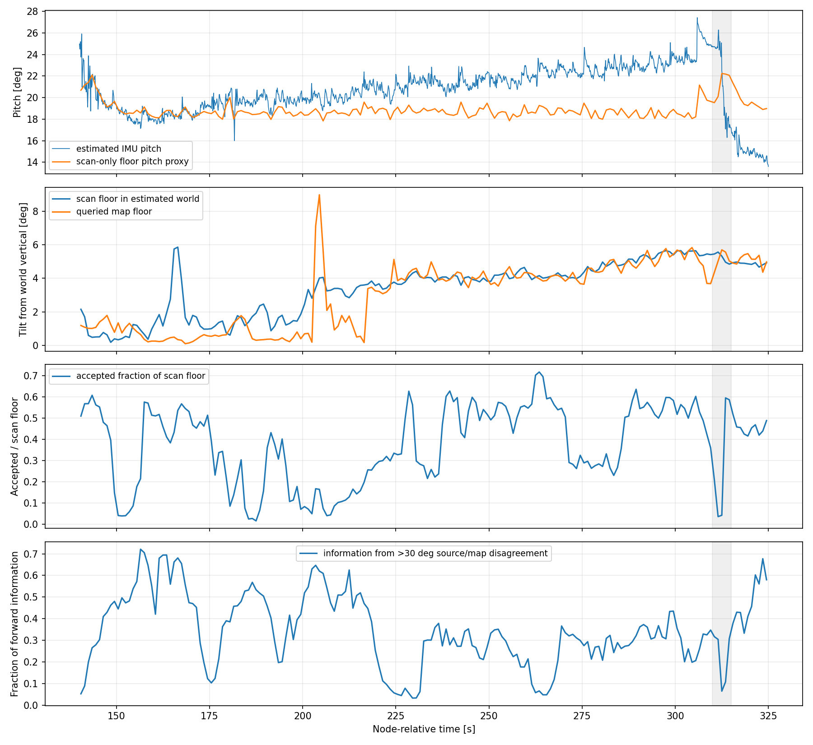
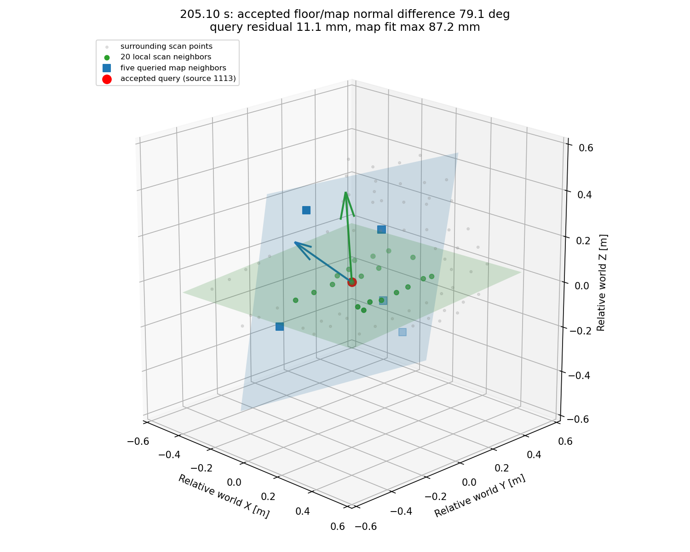
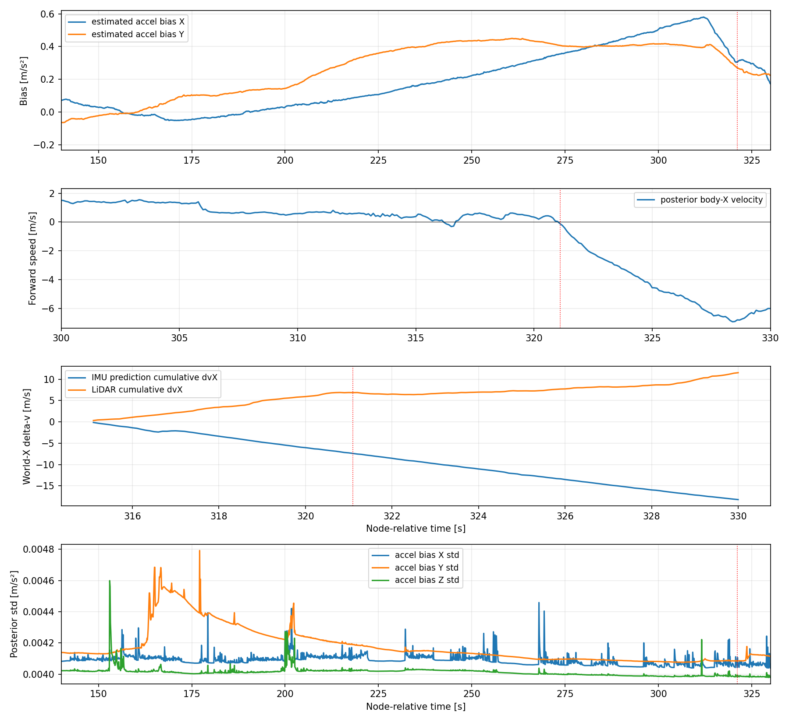

# Uターン後の後退：追加した幾何ログによる原因分析

後続の対処方針・比較順序は[対処計画（2026-09-28）](UTURN_REMEDY_PLAN.md)に整理した。

2026-09-27。140–325秒の全1,850スキャン、3,014,303採用対応点を分析した。
**不整合な地図の面対応を強い拘束として使い、姿勢のずれをbias補正に吸収し続ける経路**を確認した。
さらに、スキャンの床点を約79°異なる地図面へ対応付ける実例と、
現在の床点が過去点を置き換えられない地図更新の判定まで再構成できた。

後退の直接機構は、ターン前に相殺されていた姿勢・重力補償項と加速度bias項が、
向きが反転した後に両方とも後退側へ働くこと。
ただし、**最初に地図が崩れた瞬間や、遠方の点が面から外れる物理的原因までは未確定**。
取得開始付近ですでに問題があるため、その起点の確定には140秒以前の幾何ログが必要。
本分析は推定器の修正や、対策後の改善を実証したものではない。

## 対象とリポジトリの整合性

- 保存先: `diagnostic_captures/lio-geometry-ehdz2pcz/`。
  診断runは`run-1790505839456699151-0`。全区間3,268スキャン、約330秒まで。
- 本文の数値はすべてこの実行のもの。以前の348.4秒停止runの状態・対応点とは混ぜていない。
- 開始時に親・FAST-LIVO2両リポジトリの`git status`、`git diff`、`git log --oneline -5`を確認。
  HEADは親`7c261e9`、FAST-LIVO2`f281e70`。handoff第14節と整合した。
  診断関連ソース・設定は取得時provenanceと一致。既存の未コミット変更を保持した。
- 分析前後で両リポジトリの追跡対象ファイルの差分が完全一致した。
  [確認結果](diagnostics/geometry_capture_20260927/repository-analysis-check.json)。
  本番コード・設定・通常Logを変更せず、解析スクリプトと報告を追加した。
- 入力・記録の検査結果は[取得報告](GEOMETRY_CAPTURE.md)を参照。
  IMU入力欠落、診断の数値不整合、更新棄却を今回の原因とする証拠はない。

## 1. 床の情報を失い、地図と姿勢が一緒に傾く

地図を使わず、各スキャンの近距離点群から床候補をRANSAC・中心化PCAで求めた。
ここでいうスキャンは歪み補正・間引き後のLiDAR点群であり、完全にIMU非依存の真値ではない。
床面の適合RMSは180–300秒でおよそ6–7 mmだった。

一方、同じ床点に対する地図の5近傍はばらつき、180–220秒には床点の大半が平面適合で棄却される。
この区間の5近傍を中心化PCAで最もよく平面化しても、
平面からの最大距離の中央値は約0.18 mだった。

| 区間 [s] | 床点の平面適合棄却率 | スキャン床面のworld傾斜 [deg] | 地図床面のworld傾斜 [deg] | 両床面の角度差 [deg] |
|---|---:|---:|---:|---:|
| 180–200 | 81.4% | 1.48 | 0.41 | 1.67 |
| 200–220 | 86.4% | 3.40 | 1.39 | 2.78 |
| 220–260 | 54.5% | 4.00 | 4.03 | 0.41 |
| 280–300 | 52.5% | 5.13 | 4.95 | 0.50 |
| 300–310 | 48.2% | 5.52 | 5.33 | 0.43 |
| 320–325 | 54.8% | 4.87 | 5.14 | 1.04 |

傾斜は固定world重力軸との角度。角度はスキャンごとの値の中央値、棄却率は点数集計。
地図床面は、その床点が実際に参照した近傍集合から別途推定した。
単純に地図の全採用法線を平均した値ではない。

180–200秒と280–300秒で、スキャン床面から求めたIMU座標系のpitch指標は
**18.58°→18.52°**とほぼ同じだが、推定IMU pitchの平均は**19.73°→23.01°**となる。
IMU加速度平均からのpitch指標も**19.13°→19.06°**で、大きくは変わらない。
局所床面や加速度平均を姿勢真値とは扱わないが、推定だけが徐々に傾くことを支持する独立した材料になる。

220秒以降はスキャン床面と地図床面が近い向きになり、局所的な面整合を保ったまま両者が傾く。
したがって、点―平面残差を小さくするだけでは重力に対する姿勢のずれを検知できない。



図は幾何量を1秒ごとの中央値に集約。床面表示には支持点150以上、RMS 15 mm未満を使用した。
本文の主要集計とゲイン分解には全スキャンを使用している。

## 2. 床点をほぼ垂直な面として採用する実例

**205.099543秒、scan 2018、最終反復2、source_index 1113、match_index 266**。

| 項目 | 値 |
|---|---:|
| スキャン床面からの点の距離 | 0.84 mm |
| 点の周囲20点の平面RMS | 7.13 mm |
| スキャン床面と採用地図法線の角度差 | 79.12° |
| 採用された点―地図面残差の絶対値 | 11.08 mm |
| 地図5点の平面適合最大誤差 | 87.18 mm |
| 現行の平面適合閾値 | 100 mm |

スキャン床面のworld法線は`[-0.0248, -0.0651, 0.9976]`、
採用法線は`[-0.9781, 0.1167, 0.1725]`。
床に沿う点が、主に進行方向Xを拘束する別向きの面へ対応付けられている。
**異なる面でも交差付近では点―平面残差が小さい**ため、現在の残差判定を通過する。

この5近傍を中心化PCAで再計算しても、現行法線との違いは1.06°、床との違いは78.27°。
近傍共分散の`λ1/λ2=0.349`で、ほぼ線状の点集合でもない。
QRからPCAへの変更や線状近傍の除外だけでは、この例を解消できない。



[座標・固有値・法線の数値](diagnostics/geometry_capture_20260927/false-floor-match.json)。
現行の平面判定は[voxel_map.cpp](../humble_ws/src/fast-livo2/src/voxel_map.cpp)の
`estimateFastLioPlane`と`BuildResidualListFastLio`。
採用後は地図面の不確かさを加えず、全対応に`R=0.001 m²`を使う。

## 3. 過去点を保持し、現在の面の点を追加しない地図更新

上の5近傍について、140秒以降の過去スキャンを更新後姿勢でworldへ変換し、
地図格納時と同じfloat座標と照合した。**4点が完全一致**した。

| 近傍番号 | 一致したスキャン時刻 [s] | 取得時のLiDAR座標の距離の目安 | そのスキャンの近距離床面を延長した面からの符号付き距離 |
|---|---:|---:|---:|
| 0 | 196.999842 | 約14 m | −0.140 m |
| 1 | 193.499965 | 約19 m | +0.209 m |
| 3 | 193.998948 | 約18 m | +0.320 m |
| 4 | 200.599883 | 約9 m | −0.339 m |

これは座標が一致した生成候補の特定であり、永続点IDや実際の挿入イベントの追跡ではない。
残る1点の生成元は特定できていない。近距離床面の延長との差だけで、遠方の実地形・反射・計測誤差・
歪み補正のどれかを断定することもできない。
[照合結果](diagnostics/geometry_capture_20260927/map-point-candidates.json)。

同じ205.10秒の現在の床点を、`UpdateFastLioMap`の追加判定に通すと:

- 更新後world座標は`[20.267702, -1.331025, 0.988452]`。
- 0.5 mボクセルの中心は`[20.25, -1.25, 0.75]`。
- 現在の点の中心距離²は`0.063738 m²`、過去の近傍0は`0.028190 m²`。
- 間引きの例外条件は成立せず、**過去点の方が中心に近いため現在の点は追加候補から外れる**。

つまり、面として整合するかに関係なく、ボクセル中心に近い過去点が優先される。
ばらついた地図点を現在の平面上の点で更新できない具体例である。
推定姿勢自体にもずれがあるため、単に新しい点を無条件で優先する対策も適切ではない。
[分岐の再構成](diagnostics/geometry_capture_20260927/map-replacement-example.json)。

## 4. 不整合な対応が進行方向の情報とbias更新に入っている

各採用点のスキャン側20近傍から局所法線を求め、
十分に平面状で広がりがあるものを地図側法線と比較した。
以下の「不整合群」は、スキャン側の平面品質を満たし、法線角度差が30°を超える対応。

| 区間 [s] | 不整合群の採用点比率 | 進行方向の情報量に占める比率 | 回転を周辺化した進行方向情報の地図法線／スキャン法線比 |
|---|---:|---:|---:|
| 180–200 | 10.1% | 44.0% | 4.66 |
| 200–220 | 12.6% | 51.9% | 8.38 |
| 280–300 | 5.6% | 31.8% | 4.38 |
| 320–325 | 12.7% | 57.0% | 21.63 |

進行方向情報は、機体X軸をスキャン床面に投影した単位方向`f`について
`Σ w_i (n_i·f)²`を計算したもの。
最終列は同じ品質のよい点集合で法線だけを比較し、結合6×6ヘッセから
`S = A_tt - A_tr A_rr⁻¹ A_rt`を求めた`fᵀSf`の比の中央値。
後者でも差が残るため、回転・並進の結合を無視した集計だけによる結果ではない。
これらは記録された線形化点での幾何的な情報量で、真の精度の倍率ではない。

保存された各点の実際のゲインでbias X補正を分解すると:

- 180–200秒: 全体`+0.06766 m/s²`のうち、不整合群の正味寄与は`+0.04278 m/s²`。
- 200–220秒: 全体`+0.06251 m/s²`のうち、不整合群は`+0.02481 m/s²`。
- 180–310秒全体: 全体`+0.60604 m/s²`のうち、不整合群は`+0.17208 m/s²`。

これは実際に使われたゲインの寄与分解であり、その群を除去した場合の改善率ではない。
他の点も、すでに傾いた地図・姿勢・事前共分散の影響を受けている。
スキャン側近傍数を10・20・30に変えても、同じ1 Hz抽出スキャンの200–220秒では
不整合群が進行方向情報の52–56%を占めた。
[近傍数の感度検査](diagnostics/geometry_capture_20260927/neighborhood-sensitivity.json)。

## 5. 姿勢・biasのずれがUターン後に後退加速度になる

180–310秒の推定pitch変化を正確に分解すると、IMU予測の積算が`+4.6769°`、
LiDAR更新の積算が`+0.0240°`。
同区間の加速度bias変化は`[+0.60604, +0.29833, +0.23971] m/s²`。
bias Xの変化はほぼ全量が、共分散の相関を介した位置補正成分に対応する。
gyro bias Yの変化`−0.00042060 rad/s`も、位置補正成分`−0.00042218 rad/s`が支配的だった。
これは更新の配分の恒等式であり、回転と位置を独立な物理原因とする意味ではない。

予測式`a_W = R (s a_IMU - b_a) + g`を、同じrunのIMU区間平均・姿勢・biasから近似再構成した。
ターン後の進行方向に近いworld-X成分は次のとおり。

| 区間 [s] | `R s a_IMU + g` | `−R b_a` | 和 | 実際の予測ΔvX/Δt |
|---|---:|---:|---:|---:|
| 300–310 | −0.701 | +0.575 | −0.125 | −0.134 |
| 315–320 | −0.743 | −0.466 | −1.209 | −1.209 |
| 320–325 | −0.921 | −0.347 | −1.269 | −1.281 |

単位はm/s²。姿勢・biasは次スキャンの更新後値を使う近似で、各IMU刻みの厳密な再伝播ではない。
`s=9.81/0.9997`は今回の初期化ログの加速度ノルム、`g=[0,0,-9.81]`。
バイアスをゼロにした式でもターン後の負加速度が残り、biasリセットだけでは姿勢・地図の傾きを修正できない。

今回の継続的後退開始は**321.099643秒**。前方速度は:

`前スキャン +0.03136 → IMU予測 −0.09873 → LiDAR更新後 −0.11833 m/s`

このスキャンのX-ICP制約は0件、対応点1,506件。
以前のrunと異なり、この初反転スキャンではLiDAR更新も負方向だった。
315–320秒の累積ΔvXはIMU`−6.043`、LiDAR`+5.931 m/s`だが、
320–325秒にはIMU`−6.402`に対しLiDARは`+1.340 m/s`しか戻せない。
330秒の推定前方速度は`−6.014 m/s`。

事後bias標準偏差は約`0.004 m/s²`と小さいままである。
正解姿勢・biasがないため統計的な整合性誤差は確定できないが、
法線や地図の不確かさを無視した強い情報が入る点は、共分散を過信する具体的な経路になる。



## 対策の優先順位と、まだ言えないこと

1. **点―平面距離だけでなく、スキャン側と地図側の面の整合性を対応の品質へ反映する。**
   法線・支持点の広がり・面の不確かさを使う。今回の79°の例は、残差や地図側PCAだけでは見抜けない。
2. **ばらついた地図点をボクセル中心への距離だけで保持する方式を見直す。**
   計測距離、面との整合、複数スキャンの支持、地図への追加条件を含めて評価する。
   過去の安定した面と現在の姿勢のどちらがずれたかを区別し、無条件の新点優先を避ける。
3. **その後に、姿勢・biasの時間的な可観測性と共分散を検証する。**
   単一スキャンのヘッセやX-ICPの判定が良好でも、不正確な面が作った情報ならbiasを誤って学習する。
   IMUノイズの較正や時間積分の扱いは別途検証する。gravity/biasの一律固定やX-ICP閾値変更を根治策とはしない。

法線不整合30°超の点を除き、**同じ状態で無制約ゲインだけを再計算**した感度検査では、
180–310秒の累積bias X補正は`+0.54024 → +0.50687 m/s²`で、大きな蓄積が残る。
320–325秒の前方へ戻すΔvX補正は`+1.35589 → +2.21757 m/s`へ増えるが、
記録されたIMU予測の`−6.402 m/s`を埋める量ではない。
これは再対応・地図更新・X-ICP再判定・状態再伝播をしない局所検査であり、対策後の軌跡ではない。
**法線ゲートを1個追加すれば直る、とまでは言えない**。

現データで確認できたのは、面の不整合と地図更新が問題を保持し、姿勢・bias・予測速度の崩れへつながる経路。
140秒以前の最初の地図ずれ、遠方点の乱れが実地形・反射・計測・歪み補正のどれから生じたかは未確定。
起点まで追う次の取得では、先頭から140秒までの幾何と、地図点の生成時刻・追加棄却理由、
必要ならraw点の時刻・品質情報も記録するのが有効。
現行の誤対応・地図保持の例を再検証するための追加再生は不要。

## 再現手順と検査

リポジトリ直下から実行する。Pythonのユーザー環境のNumPyとの衝突を避けるため、下記の環境変数を付ける。
データを追加再生せず、保存済みCSVから解析用キャッシュを作る。

```bash
export PYTHONNOUSERSITE=1 OPENBLAS_NUM_THREADS=1 MPLCONFIGDIR=/tmp/mpl-lio-root
CAPTURE=diagnostic_captures/lio-geometry-ehdz2pcz
ANALYSIS=docs/diagnostics/geometry_capture_20260927

python3 "$ANALYSIS/analyze_dynamics.py" "$CAPTURE"
python3 "$ANALYSIS/extract_samples.py" "$CAPTURE"
python3 "$ANALYSIS/analyze_geometry_cause.py" "$CAPTURE"
python3 "$ANALYSIS/extract_samples.py" "$CAPTURE" --stride 1 --output-name all_frames
python3 "$ANALYSIS/analyze_geometry_cause.py" "$CAPTURE" \
  --samples-name all_frames --result-name geometry_all.json
python3 "$ANALYSIS/summarize_root_cause.py" "$CAPTURE"
python3 "$ANALYSIS/show_false_floor_match.py" "$CAPTURE"
python3 "$ANALYSIS/trace_map_example.py" "$CAPTURE"
```

結果は`$CAPTURE/analysis/root_cause/`。`all_frames/`は約1 GBの解析キャッシュ。
近傍数感度は`analyze_geometry_cause.py`に`--source-neighbors 10`または`30`と別の`--result-name`を渡す。

- 全1,850スキャン・3,014,303対応の件数を照合した。
- 各点のゲイン×innovationの和は、記録された状態補正と最大絶対誤差`2.67e-15`で一致。
- 全区間・各区間の寄与和と集計ログ、同じ状態の無制約補正の再計算も一致した。
- 大容量のキャッシュ・全スキャンの詳細派生データはGit除外の取得ディレクトリに保存。
  主要集計と図、再現用スクリプトは`docs/diagnostics/geometry_capture_20260927/`に保存した。
- 本番コードを変更していないため、ビルド・bag再生・通常Logを使うCTestは実施していない。

[全スキャンの主要集計](diagnostics/geometry_capture_20260927/root-cause-summary.json)、
[IMU予測・更新・相関成分の分解](diagnostics/geometry_capture_20260927/dynamics-decomposition.json)。
