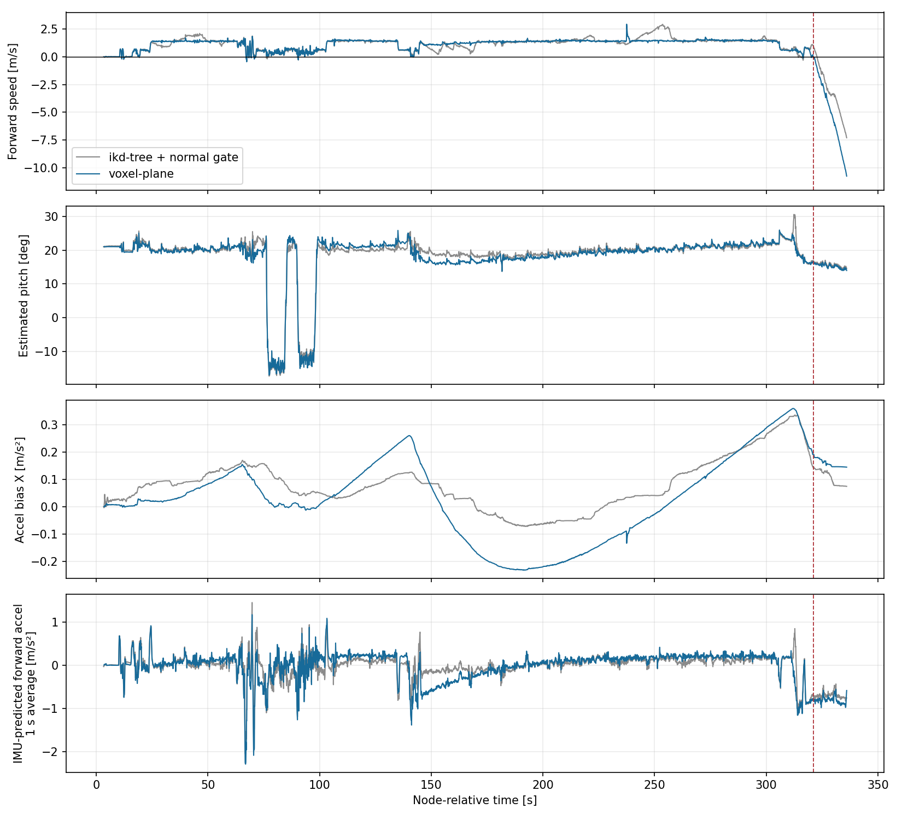
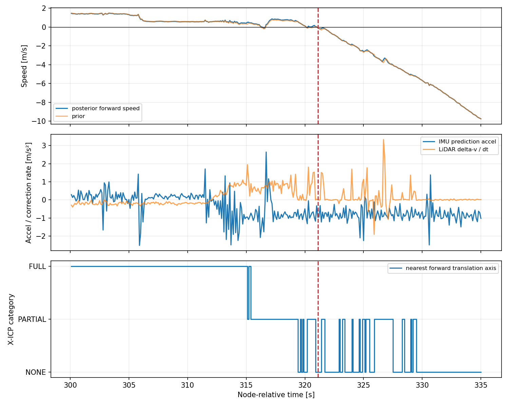

# voxel-planeでも残ったUターン後の後退（2026-09-28）

**0.5倍の最新再生でも321.10秒から持続的後退が発生した。voxel-planeへの切替は床の対応を改善したが、
姿勢・bias・地図の整合を保つ対策にはなっていない。**
品質を使うX-ICP退化判定の完成を時間的な状態推定の前提にする計画を改める。
まず確認できた共分散の座標系不整合を限定修正し、中心の開発対象を、履歴を使う姿勢・速度・bias推定と地図の再評価へ移す。

現データは今回の失敗の分析と優先順位の見直しに足りる。318秒以前の追加取得は不要。
一方、姿勢・速度・biasの真値がないため、最初の誤差の物理的起源と各修正の因果的な改善量は未確定。
今回は解析・計画更新のみで、推定コード・実行設定・バイナリを変更せず、追加bag再生も行っていない。

## 1. 今回の実行と、早期異常の実行を分ける

対象は`diagnostic_captures/lio-reconstruction-20260928-093848-xfyj5zxg/`。
runは`run-1790588346649852202-0`。保存元は[抽出記録](diagnostics/voxel_plane_failure_20260928/sample-selection.json)にも記録した。
LIO-only、rate **0.5**、voxel-plane、法線ゲートOFF、X-ICP ON。
バイナリSHA256は切替時の`0b6627da…c12c863`と一致し、保存ソースも現ファイルと全件一致した。

- 保存済みの完了スキャンは**3.499–335.999秒、3,326スキャン、12,941反復**。すべて`updated`、有限値。
- 初期地図は3スキャン・15,791点・625面でREADY。初期化の強制通過やリセットはない。
- 処理側`imu.txt`は**66,582行**、最大間隔8.34 ms、20 ms超ギャップなし。
  前回の法線ゲートON記録の同区間と、時刻・角速度・加速度が**全列完全一致**した。
- 独立IMU監視は67,201件、最大間隔8.346 ms。監視と処理の数の差は初期化などを含むため、欠落数とは扱わない。
- 解析時点でplayerは終了コード0、`summary.json`とnodeの終了情報はまだない。
  CSVサイズは再確認でも変化せず、完了済みスキャンの結合は検査できた。正常終了したcaptureとは呼ばない。

それ以前の`093324`・`093457`の2実行はrate指定なし。
後者は15.10秒頃から処理済みIMUにギャップがあり、20–30秒に通常約2,000行のところ49行しかない。
その早期異常を、入力が揃っている今回の320秒の後退へ混同しない。

全反復の補正恒等式・制約・共分散検査はPASS。最大誤差は補正9.99e−16、制約3.33e−16、
事後共分散の最小固有値は約1e−8。
幾何は宣言した時間サンプル162スキャン・716,888 query・634,164対応を検査した。
対応番号、残差、H、重み、分散内訳、共分散、ゲイン、結合ヘッセは整合した。
**全27 GBの幾何を数値検査した結果ではない**。

既存geometry検査の一律1e−6閾値だけは、面内距離の平方根で最大2.00e−6の規格化誤差を検出してFAILとなった。
floatへの丸めと差の打消しの誤差区間を別計算すると全サンプルが区間内で、他項目は閾値内だった。
元のFAIL出力と補足判定を両方保存した。これは数m/sの後退を説明する差ではない。

## 2. 対応は改善した。それでも状態の問題が残った

継続的後退の定義は、20秒以降で推定IMU X軸への速度射影が20スキャン連続で負になる最初の時刻。
異なる実行の比較なので、1–2秒の差を一般的な改善量としない。

| 指標 | ikd-tree・ゲートOFF | ikd-tree・ゲートON | voxel-plane |
|---|---:|---:|---:|
| 持続的後退の開始 | 321.10 s | 322.80 s | **321.10 s** |
| 180–310秒の加速度bias X変化 | +0.606 m/s² | +0.359 m/s² | **+0.565 m/s²** |
| 同区間pitch変化 | +4.701° | +4.077° | **+5.360°** |
| pitch変化のIMU予測／LiDAR更新寄与 | +4.677° / +0.024° | +0.681° / +3.395° | **+4.986° / +0.374°** |

今回のbias X補正+0.56501 m/s²を条件付き共分散で分解すると、位置補正成分を通る寄与は+0.56507、
回転成分を通る寄与は−0.000058 m/s²。**LiDARで位置を整合させる過程がbias更新へ流れる構造が残る**。
これは保存ゲインの分解であり、この成分を消した再生ではない。
増加の約91%（+0.5144 m/s²）は220–310秒に発生しており、以前の170–220秒だけを調べれば十分とは言えない。

床候補は地図を使わず、近距離のdeskew済みスキャンにRANSACとPCAを適用した。
下表は時間サンプルの集計であり、床が水平・真の姿勢が既知という拘束ではない。
地図側の傾斜は対応した面法線を符号整列して平均した指標で、旧5近傍からの広域平面フィットとは定義が異なる。

| 区間 | サンプル | 床候補の採用率 | スキャン床のworld傾斜 | 地図面平均法線のworld傾斜 | 両法線の角度差 |
|---|---:|---:|---:|---:|---:|
| 180–200 s | 20 | 95.5% | 1.02° | 1.39° | 0.98° |
| 200–220 s | 20 | 91.4% | 0.35° | 1.07° | 1.05° |
| 300–310 s | 10 | 96.5% | **3.77°** | **3.36°** | 1.00° |

前回は200–220秒の床点の74.7%が地図の平面適合段階で棄却されていた。
今回は床の大半を使えるのに後退しているので、**床の対応不足を直すことを主たる根治策とした説明は弱まった**。
一方、スキャンと地図が小さな相対差で一緒に傾き得る問題は残る。

## 3. 面共分散を足しただけでは、誤差の共有を表せなかった

今回の実装は`R_i = 0.001 + 面由来分散 + 点由来分散`、採用後は各点を独立な観測として更新する。
区間内の「各スキャンの点中央値」の中央値は次のとおり。

| 区間 | 実際の重み1/R | 固定0.001項の分散比率 | 面由来分散の比率 |
|---|---:|---:|---:|
| 180–200 s | 892.8 | 89.3% | **0.84%** |
| 200–220 s | 889.1 | 88.9% | **0.83%** |
| 300–310 s | 881.2 | 88.1% | **0.89%** |

ikd-treeの重みは1,000。voxel-planeは不確かな候補を下げるが、代表的な採用点の重みは約1割の低下に留まった。
これだけで観測が正しくなるとも、面共分散が一切効いていないとも言えない。
特に、**地図生成時の姿勢誤差を同じ面・複数の面で共有する相関は、点ごとの小さな対角分散では表せない**。
重みの調整だけでこの相関を消せるという前提を外す。

面の更新停止も残っている。ただし一律に主因とはしない。
200–220秒は採用点の約25.6%が更新停止面だが、同群の水平前方情報の比率は中央値約1.0%に過ぎない。
315–320秒は採用点の60.8%、前方情報の43.4%となる。
凍結面の置換だけでターン前のbias蓄積を説明・解消できるという証拠はない。

300–310秒の事後標準偏差中央値は回転接空間で約0.044°／0.014°／0.021°、
加速度biasは約0.0040 m/s²。これは地図の共通傾斜を含む真の誤差棒ではない。
真値がないので確率的整合性を正式に棄却したとは言えないが、この小さな共分散を状態の正しさの根拠にできない。

## 4. ターン後に何が速度を反転させたか

315–320秒のIMU予測加速度は前方平均**−0.718 m/s²**。
保存姿勢と処理済みIMUで近似分解すると、姿勢・重力補償と実運動を含むbias以外の項が**−0.463**、
bias補正項が**−0.253 m/s²**。ゼロbiasへ戻すだけでも負の項が残る。

180–310秒は予測の前方速度増分累積+17.77 m/sに対し、LiDAR更新が−18.65 m/sを与え、
ほぼ一定の前進速度を維持していた。ターン後は予測が後退側へ変わり、観測が支え切れなくなる。
累積は各時刻の前方軸への射影なので、単一world軸の端点速度差とは同一ではない。

| 321.099643秒の最初の持続的反転 | 値 |
|---|---:|
| 前スキャン事後の前方速度 | +0.03327 m/s |
| 今回の事前前方速度 | −0.06252 m/s |
| 今回の事後前方速度 | −0.06177 m/s |
| 予測の前方加速度 | **−0.9594 m/s²** |
| LiDAR速度補正の事前前方軸成分 | **+0.000691 m/s** |
| 同じ状態・同じ対応の無制約ゲインなら | +0.01997 m/s |

この時点は回転3方向がFULL、並進1方向がNONE。そのNONE軸と前方軸の内積絶対値は0.941。
X-ICPはこの瞬間の回復補正を減らしているが、無制約補正も約0.096 m/sの予測減速に足りない。
315–320秒の補正和は実際+3.284、同状態の無制約+3.210 m/sであり、一貫してX-ICPが悪化させたわけでもない。
「X-ICPをOFFにすれば解決」と結論しない。

1回目のターンを含む140–180秒は、予測−15.54 m/sにLiDAR+15.93 m/sが対応できていた。
2回目の後、325–330秒は予測−3.74にLiDAR+0.68、330–336秒は予測−5.08にLiDAR+0.05 m/s。
**状態推定の偏りと、前方の観測情報の不足が重なったときに持続的後退になる**という機構を支持する。
重み付きX-ICPが退化をより厳しく検出するだけなら、偏った予測へさらに依存する可能性がある。

## 5. 別途確認した、共分散の座標系不整合

以下3箇所で、回転誤差に由来する点共分散にworld回転を掛けず、worldの点共分散へ加えている。

- [照合時の点共分散](../humble_ws/src/fast-livo2/src/voxel_map.cpp#L600)
- [初期地図の点共分散](../humble_ws/src/fast-livo2/src/voxel_map.cpp#L999)
- [地図追加時の点共分散](../humble_ws/src/fast-livo2/src/LIVMapper.cpp#L507)

現在の回転誤差はIMUの右接空間なので、`p_I = R_IL p_L + t_IL`、`p_W = R_WI p_I + t_WI`に対して
`J_rotation = −R_WI [p_I]×`となる。独立ブロック近似を維持するだけでも、回転項は
`R_WI [p_I]× P_rotation [p_I]×ᵀ R_WIᵀ`が必要。
現実装は外側の`R_WI ... R_WIᵀ`がなく、初期地図では外部変換後の点も使っていない。
照合経路では計測共分散の外部回転も抜けているが、今回MID360の外部回転はidentityなのでその項の影響はない。

独立な有限差分でヤコビアンの最大誤差3.94e−9を確認した。
world軸を回したとき、現式は共分散が同じ回転で移る性質を満たさず、正しい式では誤差2.15e−18だった。
これはコード上の不整合として修正すべきもの。

ただし、保存された面・候補を固定し、**query側の座標系だけを修正**する局所検査では、
分散ゲートの採否が変わったのは681,266候補中1,096件（0.161%）。
地図生成時から直した場合の面や再対応は評価していない。
**このバグ一つが320秒の後退を起こしたと断定せず、限定修正の比較と時間的整合性の開発を分ける。**

## 6. 修正する優先順位

1. **共分散の座標系・接空間を修正し、単独で比較する。**
   3経路でLiDAR→IMU→worldを統一し、有限差分・world回転に対する共変性をテストする。
   完全なモデルでは`J_pose P_pose J_poseᵀ`の回転・位置交差項も扱う。
   ゲート／地図の不確かさと、状態更新の観測雑音を区別し、事前姿勢の不確かさを観測Rに二重加算しない。
   この修正のためにIMU雑音・較正・X-ICP閾値をまとめて変えない。
2. **主対策を、姿勢・速度・gyro bias・accel biasの時間窓推定へ移す。**
   raw IMUと時刻付きLiDARを保持し、複数時刻をIMU因子と面観測で同時推定する。
   ターンの励起と、その前後の速度・姿勢を使って、位置残差だけをbiasへ吸収する自由度を検査する。
   固定地図を真値として短い窓を足すだけにはしない。取得姿勢と局所面の履歴を持ち、
   修正した姿勢・biasで歪み補正と面を再評価できる最小限の地図管理も同時に実装する。
   窓長はターンを含む情報量と計算負荷で決め、古い誤ったbiasを強い周辺化事前へ固定しない。
3. **点・面・取得姿勢の共有誤差を観測モデルに入れる。**
   同じ面を参照する残差の共通成分を、面変数とその消去、またはブロック共分散で扱う。
   さらに同じ取得姿勢で生成した複数面の相関も考慮する。
   「一面一票」や一律分散増大を根拠なく導入せず、観測点を複製しても共有誤差の情報が無限に増えないことを検査する。
4. **重み付きX-ICPは補助対策として独立評価する。**
   R1bを時間窓R2の必須前段から外す。観測がない方向を正確にNONEにしても、IMUの偏りは直らない。
   biasを抑える暫定更新も、観測可能性・ゲイン・Joseph共分散を揃えた比較用とし、誤ったbiasの凍結を根治にしない。

時間窓でも真に観測のない方向は復元できない。
この場合は較正・時刻を確認した視覚、真の静止区間、将来取得する車輪速度などの独立情報が必要。
まず既存raw bagで検証し、現在ない車輪オドメトリの取得を今回の分析開始条件にはしない。

合格条件は、bias値が小さくなることや後退が数秒遅れることではない。
初期化からの同一入力で、220–310秒の状態・地図の整合、ターン後の持続的予測減速、
LiDAR補正との収支、360秒以降の症状、共分散と処理欠落を確認する。
最初の誤差を較正・IMU雑音・歪み補正・地図のどれかに断定するには、独立参照と修正ごとの再生比較が残る。

## 7. 保存物

- [解析手順・スクリプト](diagnostics/voxel_plane_failure_20260928/README.md)
- [状態・IMU・区間集計](diagnostics/voxel_plane_failure_20260928/dynamics-summary.json)
- [面・重み・床の区間集計](diagnostics/voxel_plane_failure_20260928/geometry-windows.json)
- [共分散の座標系検査](diagnostics/voxel_plane_failure_20260928/covariance-frame-audit.json)
- 派生CSV・全サンプル解析: `diagnostic_captures/voxel-plane-analysis-20260928/`。
  元captureは変更していない。
