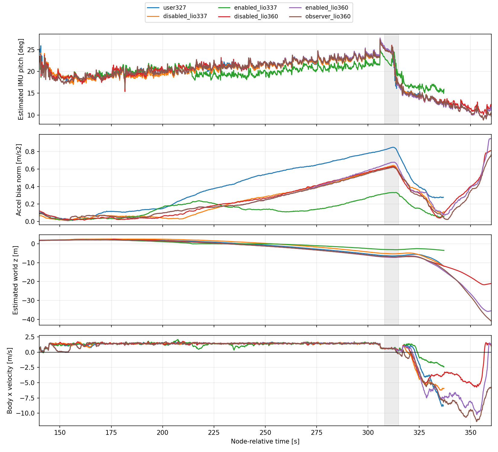

# Uターン後の後退：蓄積区間の追加診断（2026-09-27）

`handoff.md` の Next actions 1–4 に従った継続調査。証拠保存先は
`/tmp/fast-livo2-onset-tsoyp5w7/`。前回証拠は
`/tmp/fast-livo2-xicp-327s.ELNtlC/REPORT.md`。
解析・観測用ソースは [diagnostics/xicp_onset](diagnostics/xicp_onset/) に保存した。

## 作業開始時の整合性

`git status`、`git diff`、`git log --oneline -5` を親・内部repoで確認した。
両方のブランチは `feat/xicp-degeneracy`、HEADは親 `7c261e9`、内部 `f281e70`。
tracked差分は親5ファイル +60/-16、内部10ファイル +751/-187でhandoffと一致。
新規X-ICP実装・tests等のuntrackedファイルも存在し、staged差分はなかった。

本番バイナリ SHA256:
`88740378e9b283028f539197dab03ecbe31cb9726cacb95d64be47ac6c380dc5`

本番YAMLおよび前回保存YAML SHA256:
`f86566c9e30a8648ee552f108a1503f9b1f1ae7ffd4b81c49764242538f71386`

`fastlio_knn`、X-ICP有効、gravity固定・bias推定有効、IMU初期化3秒、較正値を確認した。
この調査では本番ソース・設定・バイナリ・`Log/`を変更していない。
Dockerにはrepo全体をread-onlyでマウントし、`Log/`だけを新規の一時保存先に重ねた。

## 保存ログから絞った蓄積区間

ユーザーの直近ログでは、加速度biasのX成分は170秒台から増加へ転じる。
200–220秒ではY成分も大きく増加する。異常を327秒の瞬間だけで調べるのではなく、
**170–220秒を上流の重点区間**とする。これは観測された状態変化の始点候補であり、
センサーの真のbias変化や原因発生時刻を断定したものではない。

| 区間 [s] | 平均推定pitch [deg] | raw加速度の重力のみ仮定によるpitch [deg] | bias Xの傾向 [m/s²/s] | bias Yの傾向 [m/s²/s] |
|---|---:|---:|---:|---:|
| 160–170 | 18.347 | 19.164 | -0.00383 | +0.00740 |
| 170–180 | 19.144 | 19.094 | +0.00196 | +0.00197 |
| 180–190 | 19.767 | 19.240 | +0.00346 | +0.00335 |
| 190–200 | 19.688 | 19.014 | +0.00312 | +0.00103 |
| 200–210 | 19.928 | 19.141 | +0.00224 | +0.01082 |
| 210–220 | 20.598 | 19.346 | +0.00361 | +0.00841 |

biasの傾向は各10秒窓で時刻に線形回帰した傾き。raw加速度には走行加速度が含まれるため、
表の加速度由来pitchは姿勢の正解値ではない。IMU取り付け角も含むのでpitchを0度に固定しない。

180–310秒のスキャン単位分解:

| 項目 | IMU予測の累積寄与 | LiDAR更新の累積寄与 |
|---|---:|---:|
| pitch変化 [deg] | +4.6728 | +0.0870 |
| world-X速度変化 [m/s] | -20.6063 | +21.5885 |
| accel bias X変化 [m/s²] | 0 | +0.59703 |
| accel bias Y変化 [m/s²] | 0 | +0.47662 |
| accel bias Z変化 [m/s²] | 0 | +0.24296 |

予測寄与は `prior[i] - posterior[i-1]`、LiDAR寄与は `posterior[i] - prior[i]`。
加速度bias・gyro biasの予測前後差は、利用した全保存ログで数値的に0。
したがってbiasの増加はLiDAR更新を介して生じている。一方、pitchの累積変化は予測側が支配し、
LiDARは速度を強く補正しながらこのpitch変化をほぼ残している。
これは状態推移の分解であり、真値に対する誤差の厳密な原因分解ではない。

同区間のpitchに最も近い回転固有方向（LiDAR/body Yとの絶対内積最大）は、
**5,154/5,154反復でFULL**。Yとの絶対内積の中央値は0.992。
pitch補正をNONE/PARTIAL制約で直接止め続けたという説明は当てはまらない。
なお、他方向の制約は結合ゲインを通してpitchに影響し得る。

推定高度も約+2.35 m（180秒直前）から-6.41 m（310秒直前）へ変化している。
地図との整合を保った姿勢・biasのドリフトを疑う材料だが、正解高度や床面法線との照合前に
地図変形と断定しない。

## 観測専用バイナリ

本番 `voxel_map.cpp` のコピーに、状態更新後の読み取り専用ログ呼び出しだけを追加した。
差分は [observer.patch](diagnostics/xicp_onset/observer.patch)。
既存のオブジェクト・コンパイルオプションを再利用し、生成物を `/validation` のみに置いた。

収集する項目:

- 結合6DoFの `HᵀWH`。回転はIMU右摂動 [rad]、並進はworld [m]。
- 対応点残差RMS・最大値、`innovation = residual - H * prior_delta.head(6)`、重み付き二乗和。
- 事前共分散を反復接空間に移した `Piter` と、確定更新後の `Pcommitted`（後者は `final=1` のみ事後値）。
- 実際のゲインの `KH`、`diag(K R Kᵀ)`、`K*innovation`、同じ事前・対応点による無制約ゲイン `K0*innovation`。
- PARTIAL/NONEの制約行列、`D*innovation` の目標、実際の補正量。
- Woodbury形式のinnovation二次形式（NIS）。地図・対応点の独立性は保証されないため、
  カイ二乗検定による合否判定には使用しない。

列単位を除くためヘッセ固有値の比較には
`diag(HᵀWH)^(-1/2) * HᵀWH * diag(HᵀWH)^(-1/2)` を使う。
生の行列も保存し、正規化した最小固有値だけで可観測性を断定しない。

12秒再生では状態出力88行が既存バイナリと完全一致。
338反復のログはすべて有限値、補正恒等式の最大誤差は9.92e-14、
確定共分散の最小固有値は約1e-8、非対称誤差は0だった。
この一致は短時間の確認であり、長時間の非決定性まで解消するものではない。

## 360秒比較の条件と再現性の限界

bag `raw_20260907_114335`、LIO-only、rate 1.0、RELIABLEセンサーQoS、RVizなし、
`FAST_LIVO2_DETERMINISTIC=1`、`OMP_NUM_THREADS=1`、同一Dockerイメージ。
比較用の有効・無効は同じ本番バイナリを使い、無効側のみ起動パラメータでX-ICPを無効化した。
追加の観測用再生は別の実行として扱う。

DDSドメインとログ保存先を分離。無効側の途中には診断ビルドと短時間再生を、
有効側には追加診断再生を並行実行したため、CPU負荷は完全同一ではない。
同じIMU入力・スキャン時刻・点数の照合により入力欠落を検査するが、後退開始時刻差を
X-ICPの一般的な改善量には解釈しない。

ソース確認では `FAST_LIVO2_DETERMINISTIC` は近傍探索等のOpenMPスレッド数を制御する一方、
ikd-treeは独立のpthreadで再構築を行い、この環境変数を参照しない。
非決定性の候補だが、再構築と対応点を直接記録していないため原因としての確定はしていない。
既存の有効337秒実行と有効160秒実行は、IMUログの共通範囲が完全一致していても41.4993秒から
状態出力が異なる。ユーザーの直近実行との違いは12.2001秒から現れる。

## 追加観測の結果

観測用の別実行は360秒、3,568状態・14,130反復を記録した。すべて有限値で、
制約補正誤差の最大値は6.03e-13、補正恒等式の誤差は1.01e-12以下。
確定共分散は対称で、最小固有値は約1e-8。X-ICP更新棄却・観測処理エラーは0件。
以下はユーザーの元ログそのものではなく、追加診断実行の数値である。

各区間の最終反復での中央値:

| 区間 [s] | 残差RMS [m] | 正規化結合ヘッセの最小固有値 | `(KH)[rotY,rotY]` | 事後rotY標準偏差 [deg] | 事後bias X標準偏差 [m/s²] |
|---|---:|---:|---:|---:|---:|
| 180–200 | 0.04879 | 0.115 | 0.9924 | 0.02472 | 0.00411 |
| 200–220 | 0.04567 | 0.161 | 0.9907 | 0.02342 | 0.00411 |
| 280–300 | 0.03779 | 0.139 | 0.9984 | 0.01574 | 0.00405 |
| 300–310 | 0.02978 | 0.192 | 0.9968 | 0.01945 | 0.00406 |
| 320–325 | 0.05392 | 0.184 | 0.9939 | 0.01664 | 0.00406 |
| 337–360 | 0.05859 | 0.237 | 0.9978 | 0.01248 | 0.00406 |

rotYは右摂動のIMU Y成分であり、Euler pitchそのものではない。
少なくとも代表値では、pitchに近い回転方向のゲイン消失や結合ヘッセの極端なランク欠落が
支配している形ではない。フィルタは地図に対する姿勢・biasを小さい共分散で扱っている。
この共分散が実際の誤差を正しく表しているかは、地図誤差や観測相関を含む評価が必要。

**FULLの方向も、並進方向の制約を通して補正量が変わることを確認した。**
180–200秒から「回転の3固有方向がすべてFULL」の最終反復128行だけを選んでも、
同じ事前・対応点・反復状態に対して次の差があった:

| 補正量の成分の累積 | 実際の制約付きゲイン | 同じ状態で計算した無制約ゲイン |
|---|---:|---:|
| 右摂動rotY成分 [deg] | -0.7960 | -1.4783 |
| accel bias X成分 [m/s²] | +0.05019 | +0.00658 |

比較した量は `K*innovation`。回転欄は各接空間成分の和で、Euler pitchの累積変化と同一ではない。
この条件では回転方向を直接PARTIAL/NONEにしていないため、並進制約とその座標変換・
結合ゲインが回転とbiasへの補正配分を変えている。FULL判定だけを根拠に
「その方向には無制約更新と同じ補正が入る」とは判断できない。
ただし、この一段の比較は別の無制約軌跡の再現ではなく、X-ICP無効でも後退する
元の融合・地図の問題すべてを説明するものではない。

## 360秒比較の結果

継続的後退は315秒以降、body X速度が20サンプル連続で負となる最初の時刻。
時刻はnodeログ基準で、bag/RViz表示時刻ではない。

| 実行 | 後退開始 [s] | 約310秒のbiasノルム [m/s²] | 約327秒の前進速度 [m/s] | 約337秒の前進速度 [m/s] |
|---|---:|---:|---:|---:|
| 前回・無効337秒 | 319.3 | 0.624 | -4.923 | -5.938 |
| 前回・有効337秒 | 324.1 | 0.326 | -1.142 | -2.413 |
| 今回・無効360秒 | 320.9 | 0.621 | -4.851 | -3.642 |
| 今回・有効360秒 | 321.6 | 0.663 | -5.949 | -7.598 |
| 今回・観測用有効360秒 | 317.5 | 0.608 | -4.934 | -7.930 |

本番バイナリでの今回の対では開始差は0.7秒にとどまり、327秒では有効側の負速度が大きい。
前回1組の4.8秒の差を安定した改善と見なすことはできない。
観測用の実行にも同じ破綻があり、長時間の数値は追加ログによる実行タイミングの影響を含む。
12秒の完全一致は、長時間の軌跡一致を保証していない。

今回の3実行すべてが359.999秒・3,568状態まで出力し、非有限値は0。
IMU積分ログは**71,382行すべての列が完全一致**し、スキャン時刻とraw点数も完全一致。
積分ログの最大間隔は8.34 ms。

別のRELIABLE購読器によるIMU受信数は無効72,012、有効・観測用各72,010。
共通72,010サンプルのstamp列は完全一致し、差は停止端の2サンプルのみ。
最大間隔8.346048 ms、10 ms超ギャップ・重複・逆順はいずれも0。
有効と観測用はstampと角速度・加速度値を含む受信列SHA256も完全一致した。
これは監視購読器の受信記録とノードの積分記録の照合であり、ノードcallback自体に
受信カウンタを追加したわけではない。

無効側は356.699秒から2秒以上の正速度に戻るが、推定位置は終端で
約[-259.6, -12.0, -21.0] mまで進んでいる。速度符号の回復を軌跡の正しさや問題解消とは扱わない。
終了時には3実行とも従来同様、SIGINT後だけexit -11を記録した。



集計は [comparison.json](diagnostics/xicp_onset/comparison.json)、
[observer-windows.json](diagnostics/xicp_onset/observer-windows.json)、
[observer-windows-coupling.json](diagnostics/xicp_onset/observer-windows-coupling.json) に保存。
元のCSV・状態・IMUログは `/tmp/fast-livo2-onset-tsoyp5w7/` にあり、削除前に別途保全が必要。

## 対策を入れる前に残る切り分け

現時点では、単純なIMU欠落、更新の数値崩壊、pitch方向のLiDARゲイン消失という説明は
証拠と合わない。姿勢が徐々に変わる中でLiDARが速度・biasを補正し、更新された地図に再び
照合する過程が重点となる。ただし、地図の変形・対応点の誤り・実際のセンサーbiasを
独立した基準なしに完全分離できていない。

次は170–220秒で、対応点の法線・位置・残差の分布、地図の床／壁面の傾き、
同じ面への繰り返し観測を記録し、rawスキャン側の平面と照合する。
FULL方向にも及ぶ制約ゲインの影響は、同じ事前・対応点での `K0*innovation` との差で追える。
ただし、これは単一更新の比較であり、X-ICPを無効にして長時間再生した軌跡そのものではない。

このbagにあるのはLiDAR・IMU・画像・camera_infoで、独立した車輪／脚オドメトリや姿勢の正解はない。
確実な静止区間、既知平面、別の速度観測が利用できる場合は、それを整合性評価に使う。
本番のbias固定、重力・較正変更、閾値調整は今回実施していない。
まずこの切り分けから対策を選び、LIOで検証してからLIVOへ進む。

## 再実行

[replay.py](diagnostics/xicp_onset/replay.py) は `/validation` 以下に新規実行ディレクトリを作る。
ROS環境をsourceしたコンテナ内で使用する。repoは `/external:ro`、一時保存先は `/validation`、
空のログディレクトリは `/external/humble_ws/src/fast-livo2/Log` に書き込み可能でマウントする。
network-noneではsetup後に `unset CYCLONEDDS_URI` が必要。

```bash
python3 /validation/replay.py disabled_lio360 --duration 360 --rate 1 --param lio.xicp.enabled:=false
python3 /validation/replay.py enabled_lio360 --duration 360 --rate 1
python3 /validation/build_observer.py
LIO_OBSERVER_FILE=/validation/observer360.csv python3 /validation/replay.py observer_lio360 --duration 360 --rate 1 --binary /validation/fastlivo2_observer
```

各実行は空のLogディレクトリで開始する。別の実行を同じLogに同時に書き込まない。
実行名が既に存在するとスクリプトは停止する。

ホスト側の解析例（NumPy必須、プロットはMatplotlib）:

```bash
PYTHONNOUSERSITE=1 python3 docs/diagnostics/xicp_onset/onset.py /tmp/fast-livo2-xicp-327s.ELNtlC --out /tmp/onset-analysis
PYTHONNOUSERSITE=1 python3 docs/diagnostics/xicp_onset/analyze_observer.py /tmp/fast-livo2-onset-tsoyp5w7/observer360.csv --out /tmp/observer-windows.json --xicp /tmp/fast-livo2-onset-tsoyp5w7/observer_lio360/xicp_diagnostic.csv
```

`mat_pre/out` のEuler角は実装上rad×57.3で保存され、X-ICP CSVのpitchはrad。
解析で両者を区別し、前進速度はbody Xへの射影で判定する。
